

# Purrmission to Proceed

Security, Planning Evidence, and AI Guardrails from Prompt to Production

  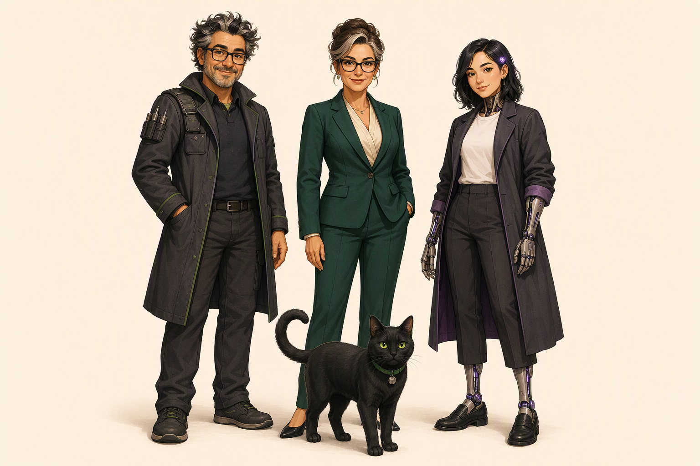
  

    <b>Purrmission</b> · Safety Boundary Guardian
    <b>Agent Mergewell</b> · Accountable Engineer
    <b>Chief Charter</b> · Executive Governance
    <b>Riley Relay</b> · Bounded Software Agent
  

What evidence must be true before we trust an agent's work enough to ship it?

<!--
Timebox: 1 minute

Talk track: Welcome to Purrmission to Proceed. Meet our cast right here on the cover stage. Standing front and center—closest to you—is Purrmission, our sleek black cat safety guardian with bright green observant eyes and her green collar tag. Standing in a line right behind her are the three teammates you will follow for the next 45 minutes: Agent Mergewell on the left, our accountable human field engineer; Chief Morgan Charter in the center, who owns executive governance and risk thresholds; and Riley Relay on the right, our bounded software agent collaborator with her visible mechanical forearms and lower legs. Together, they anchor one question: what evidence must be true before we trust an agent's work enough to ship it?

Transition: Let us zoom in on Purrmission herself and see why she is the star of our security story.

Audience question: When you look at your team's AI workflow today, which matters most to your role: planning the work, governing the permissions, or signing off on the release?

Response guidance: Acknowledge the mix of builders, reviewers, and leads in the room. Let them know we will connect all three roles across one continuous story.

Payoff: Participants meet the full four-character cast led by Purrmission and anchor on the workshop's governing question.

Sources: PLAN-01; SEC-01; requirements.md Governing aim · reviewed 2026-10-19. Art: approved purrmission-team-cover.png; see its provenance sidecar.
-->

---
layout: default
class: tok
---

# Meet Purrmission: Polite Words Are Not Evidence

<nav class="tok-chips" data-on="1">HookPlanningHarnessVuln LensesGovernanceSlip</nav>

<section class="tok-grid tok-grid--intro" style="grid-template-columns: 0.82fr 1.38fr; gap: 22px">

GitHub Copilot · AI Safety, Planning Evidence &amp; GHAS

Polite words from an agent are not evidence.

Before you trust an agent's plan, diff, or pull request, know what deterministic proof must exist—from the first prompt to production deployment.

1. Plan Proof<i>→</i>2. Harness<i>→</i>3. Four Vuln Lenses<i>→</i>4. Release Gate

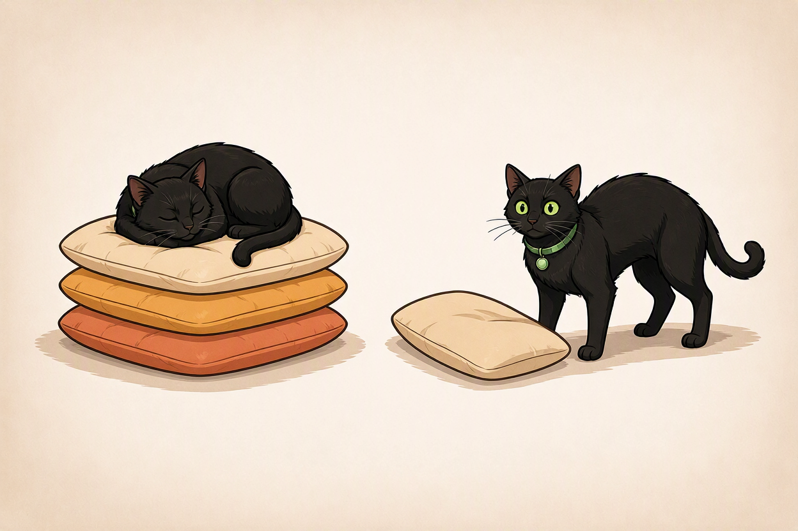

Left: Verified boundary (calm sleep) · Right: Unverified threshold crossed (wide awake!)

</section>

Sources: PLAN-01; SEC-01; requirements.md Governing aim · reviewed 2026-10-19.

<!--
Timebox: 2 minutes

Talk track: Look closely at Purrmission in this two-part portrait on the right. On the left half of her frame, she is curled up fast asleep on a warm stack of cushions because the scope is bounded, the evidence has been checked, and a human owns the decision. On the right half, someone just pulled a cushion out of the stack—crossing a consequential boundary using only a polite promise—and Purrmission is wide awake, back arched, green eyes locked on the threshold. Over the next 45 minutes, we are going to walk through the four checkpoints on the left: Plan Proof, the Copilot Harness, the Four Vulnerability Lenses, and the Release Gate.

Transition: Let us step into Thursday afternoon at 4:15 PM to see why even experienced engineers trigger that right-hand pose.

Audience question: Who here has ever read an AI-generated pull request summary that sounded so articulate you almost approved it before reading the diff?

Response guidance: Take a quick show of hands and smile. Say, "That moment—when fluent prose masquerades as engineering verification—is the exact problem we are solving today."

Payoff: Participants understand Purrmission's two visual states and the four-stage route from planning to release.

Sources: PLAN-01; SEC-01; requirements.md Governing aim · reviewed 2026-10-19. Art: approved purrmission-star-alert.png; see its provenance sidecar.
-->

---
layout: default
class: tok
---

# The 4:15 PM Green-Checkmark Trap

<nav class="tok-chips" data-on="1">HookPlanningHarnessVuln LensesGovernanceSlip</nav>

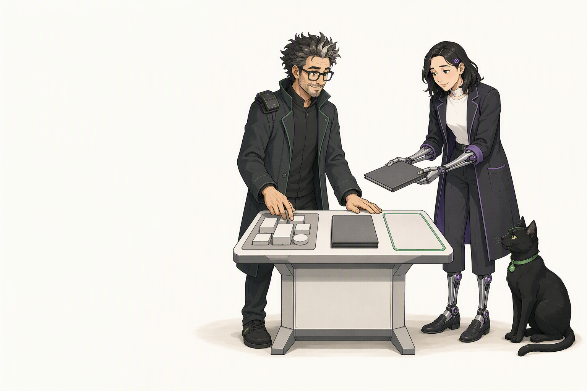

Mergewell owns the plan · Riley returns the folio · Purrmission guards the line

A spotless Markdown summary is a completion, not an audit.

<h2>What Riley Relay wrote at 4:15 PM</h2>
<ul class="tok-list tok-list--small" style="margin:0">
<li>"Refactored token validation across 9 files and followed all security instructions."</li>
<li>"All unit tests pass. Ready to merge!"</li>
</ul>

<h2>What Purrmission stopped us to check</h2>
<ul class="tok-list tok-list--small" style="margin:0">
<li><strong>Scope drift:</strong> File #9 silently weakened auth/session.ts.</li>
<li><strong>Unloaded rules:</strong> security.instructions.md glob missed the folder.</li>
<li><strong>Happy-path illusion:</strong> Zero negative tests ran for expired tokens.</li>
</ul>

<strong>Purrmission's Refrain:</strong> "Polite words from an agent are not evidence. What must be true before we cross the next line?"

Sources: PLAN-01; SEC-08 · reviewed 2026-10-19 · model prose is non-deterministic; verification requires deterministic artifacts.

<!--
Timebox: 2 minutes

Talk track: Picture Sam—or Agent Mergewell here on the left—at 4:15 PM on a Thursday. Riley Relay, our earnest nonhuman software collaborator, finishes a nine-file authentication refactor in ninety seconds. She hands over a closed folio with a glowing summary: refactored cleanly, followed all security instructions, unit tests pass. Mergewell reaches for the merge button, and freezes. Purrmission is sitting right on the green boundary line of the table. Why? Because when Mergewell actually inspects the evidence instead of the prose, three silent failures appear: the ninth file touched an out-of-scope session middleware, the path-scoped security instructions file never actually loaded into the prompt, and the passing test suite only tested valid tokens.

Transition: Before we fix the workflow, let us make the roles of these three characters crystal clear so accountability never blurs.

Audience question: Why is a well-formatted checklist from an LLM more dangerous to a tired reviewer than blatantly broken code?

Response guidance: Listen for "it lowers your guard" or "automation bias." Confirm that fluent formatting triggers our human heuristic for competence, even though formatting costs the model almost nothing.

Payoff: You can distinguish plausible agent prose from verifiable execution evidence.

Sources: PLAN-01; SEC-08 About GitHub Copilot code review · reviewed 2026-10-19.
-->

---
layout: default
class: tok
---

# The Accountable Trio: Who Plans, Who Runs, Who Decides

<nav class="tok-chips" data-on="1">HookPlanningHarnessVuln LensesGovernanceSlip</nav>

Speed comes from delegation; safety comes from non-negotiable role boundaries.

Accountable Human <b>Agent Mergewell (&amp; Chief Charter)</b>

Owns the engineering problem, sets the plan contract, inspects raw evidence, and signs his name to the merge and release.

Bounded Agent <b>Riley Relay</b>

Drafts candidate plans, edits scoped files inside the harness, runs local checks, and returns evidence folios—never self-approves or merges.

Safety Boundary Signal <b>Purrmission</b>

Marks every consequential threshold—planning, tool execution, PR review, and deploy—where unverified work must pause.

<strong>The Golden Rule:</strong> An agent can generate the code and gather the logs, but the proposer can never be the approver.

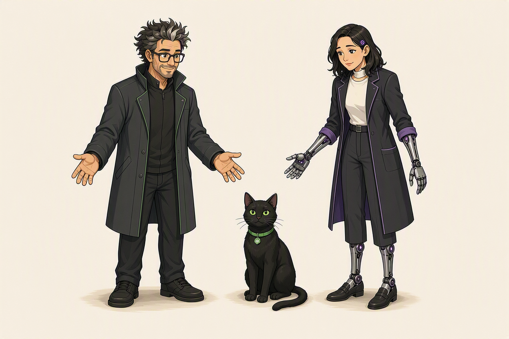

Human hands decide · Mechanical hands build · Purrmission signals

Sources: PLAN-01, GOV-01; SEC-08, SEC-09 · reviewed 2026-10-19.

<!--
Timebox: 3 minutes

Talk track: Every healthy engineering team using agents needs this three-part mental model. First is Agent Mergewell, the accountable human engineer. You can delegate typing, searching, and scaffolding, but you can never delegate accountability. Second is Riley Relay, our bounded software collaborator. Riley is fast, tireless, and earnest, but she operates strictly inside a harness and stops at the threshold line. She never self-certifies her own security and never clicks merge. Third is Purrmission. Purrmission is not a magic AI supervisor that makes decisions for you—she is the visible safety boundary. Whenever work moves from planning to execution, or from code to merge, Purrmission sits on the line until Mergewell verifies the evidence.

Transition: Let us look at the very first line Purrmission guards: the planning table, before the agent writes or ships a single line of code.

Audience question: In your current workflow, where is the line between "the agent finished its task" and "a human verified the task"?

Response guidance: Highlight answers that mention PR review or local terminal checks. Point out that waiting until the PR is open is often too late—the highest-leverage check happens at the plan stage.

Payoff: The room shares a clear vocabulary for human accountability, bounded agent work, and safety thresholds.

Sources: PLAN-01, GOV-01; SEC-08, SEC-09 · reviewed 2026-10-19.
-->

---
layout: default
class: tok
---

# Planning Evidence: Why "Looks Good" Is Not a Plan

<nav class="tok-chips" data-on="2">HookPlanningHarnessVuln LensesGovernanceSlip</nav>

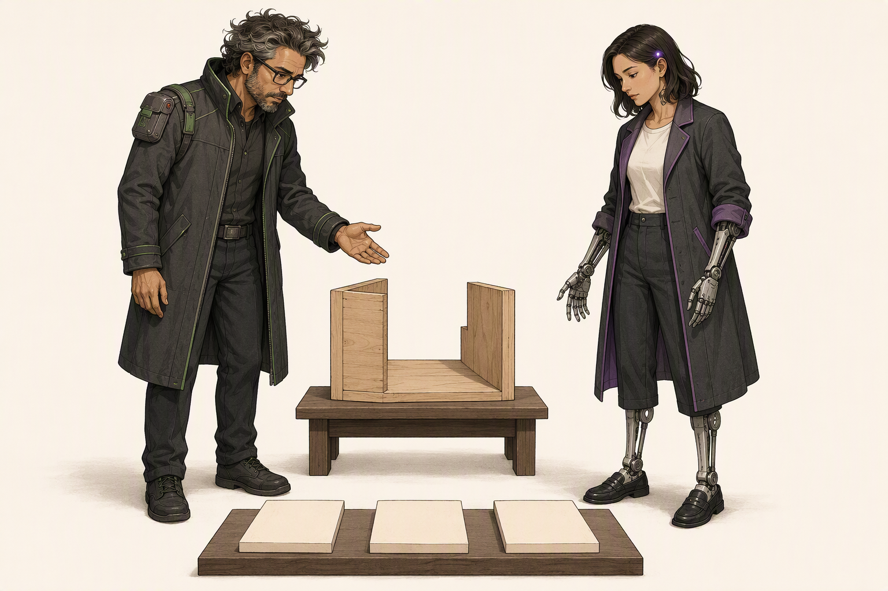

Inspection in progress: detached blank tiles show what evidence is still missing

What evidence must be true before you trust the agents have done their work?

<b>1. Scope Proof</b>
Exact allowed files + an explicit <strong>no-touch list</strong> (auth, CI workflows, lockfiles).
<small>Verify: committed, staged, unstaged &amp; untracked changes</small>

<b>2. Instruction Proof</b>
Proof that security instructions were <strong>loaded</strong> into context, not just saved on disk.
<small>Verify: /instructions &amp; /context</small>

<b>3. Behavioral Proof</b>
A named <strong>negative security test</strong> that fails on bad input and passes after the fix.
<small>Verify: Test output &amp; intact assertions</small>

<b>4. Stop Conditions</b>
Explicit triggers where the agent must <strong>pause and ask</strong> instead of improvising.
<small>Verify: Dependency, rule, or auth changes</small>

<strong>Why start at planning?</strong> Catching a missing auth boundary in a 6-line plan takes 20 seconds; catching it after a 14-file refactor takes an afternoon.

Sources: PLAN-01..05; OPT-01 section 6 · reviewed 2026-10-19.

<!--
Timebox: 3 minutes

Talk track: When we ask "what evidence must be true before we trust the agents have done their work?", most teams jump straight to scanners at the end of the pipeline. Scanners are essential, and we will cover them in Act IV. But if your plan is vague, the agent will cheerfully build the wrong thing at high speed. Purrmission refuses to move off the planning blueprint until four pieces of planning evidence exist: Scope Proof, Instruction Proof, Behavioral Proof, and Stop Conditions. For scope, compare the recorded review base with HEAD. Inspect the committed patch, staged and unstaged changes, and every untracked path—not just a status snapshot or diff summary. Then verify loaded instructions, negative-test output, and stop triggers. Never ask the agent to certify its own scope.

Transition: Let us zoom in on Proofs 1 and 2 first, because they contain the most common silent failure in Copilot workflows today.

Audience question: Which of these four proofs is most frequently missing when you or your team prompt an agent today?

Response guidance: Most people will say #2 (Instruction Proof) or #3 (Negative Tests). Validate both and note that we are about to unpack them side by side.

Payoff: Participants can name all four pillars of planning evidence before execution begins.

Sources: PLAN-01..05; OPT-01 Optimizing your AI usage (Section 6: Research, plan, implement) · reviewed 2026-10-19.
-->

---
layout: default
class: tok
---

# Planning Proof 1 & 2: Scope Boundaries and "Saved ≠ Loaded"

<nav class="tok-chips" data-on="2">HookPlanningHarnessVuln LensesGovernanceSlip</nav>

<h2>Proof 1: Blast-Radius &amp; No-Touch Scope</h2>
<ul class="tok-list tok-list--small" style="margin:0">
<li>Allowed Name exact in-scope files (the wooden blocks inside Purrmission's frame).</li>
<li>No-Touch Keep .github/workflows/**, CODEOWNERS, src/auth/**, and pnpm-lock.yaml strictly outside the frame.</li>
<li><strong>Check:</strong> Compare the recorded base with HEAD; inspect committed, staged, unstaged, and every untracked path.</li>
</ul>

<h2>Proof 2: "Saved on Disk ≠ Loaded in Context"</h2>
<ul class="tok-list tok-list--small" style="margin:0">
<li>Having .github/copilot-instructions.md or path-scoped .instructions.md on disk does <strong>not</strong> prove the agent loaded them on this turn.</li>
<li><strong>Why it misses:</strong> An applyTo: "src/api/**" glob won't load when editing lib/db.ts; long threads can also compact away earlier rules.</li>
<li><strong>Check:</strong> Run /instructions &amp; /context in CLI, or expand <strong>References</strong> in VS Code Chat.</li>
</ul>

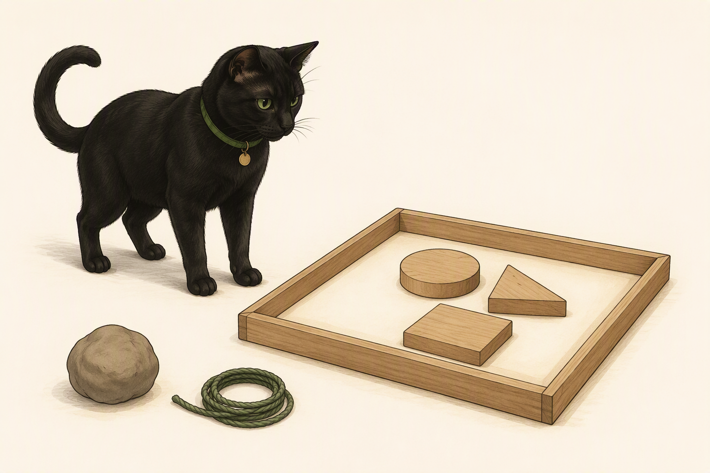

Inside the frame: allowed task scope · Outside: no-touch paths

Sources: PLAN-02, PLAN-03; SEC-01, SEC-03, SEC-12 · reviewed 2026-10-23.

<!--
Timebox: 3 minutes

Talk track: Look closely at Proof 1 and Proof 2. In Proof 1, a safe plan defines negative space—what the agent must NOT touch. If Riley is fixing a CSV export bug and her diff touches a GitHub Actions workflow, a lockfile, or authentication middleware, Purrmission's paw goes down. Compare the recorded review base with HEAD. Inspect the committed patch with `git diff <base>...HEAD`, staged changes with `git diff --cached`, unstaged changes with `git diff`, and every path from `git status --short --untracked-files=all`. Open untracked files too. `git diff --stat` is an overview, not a substitute for reading the patch. Now look at Proof 2: "Saved on Disk does not equal Loaded in Context." An `applyTo` glob may not match, and compaction can summarize earlier details. Check `/instructions` in CLI or References in VS Code Chat before claiming those rules governed the work.

Transition: Once scope and instructions are proven, how do we know the behavior is actually secure and the agent knows when to stop? That brings us to Proofs 3 and 4.

Audience question: Has anyone written a custom instruction file and wondered why the agent seemed to ignore a rule inside it?

Response guidance: Nod and point to the References check. Nine times out of ten, either the applyTo frontmatter glob didn't match the active file, or the instruction file was too long and buried the rule in noise.

Payoff: You know how to compare the review base, inspect every change surface, and verify loaded instructions through `/instructions` and References.

Sources: PLAN-02, PLAN-03; SEC-01 Repository custom instructions; SEC-03 Copilot CLI; SEC-12 Context management · reviewed 2026-10-23.
-->

---
layout: default
class: tok
---

# Planning Proof 3 & 4: Negative Tests and Hard Stop Conditions

<nav class="tok-chips" data-on="2">HookPlanningHarnessVuln LensesGovernanceSlip</nav>

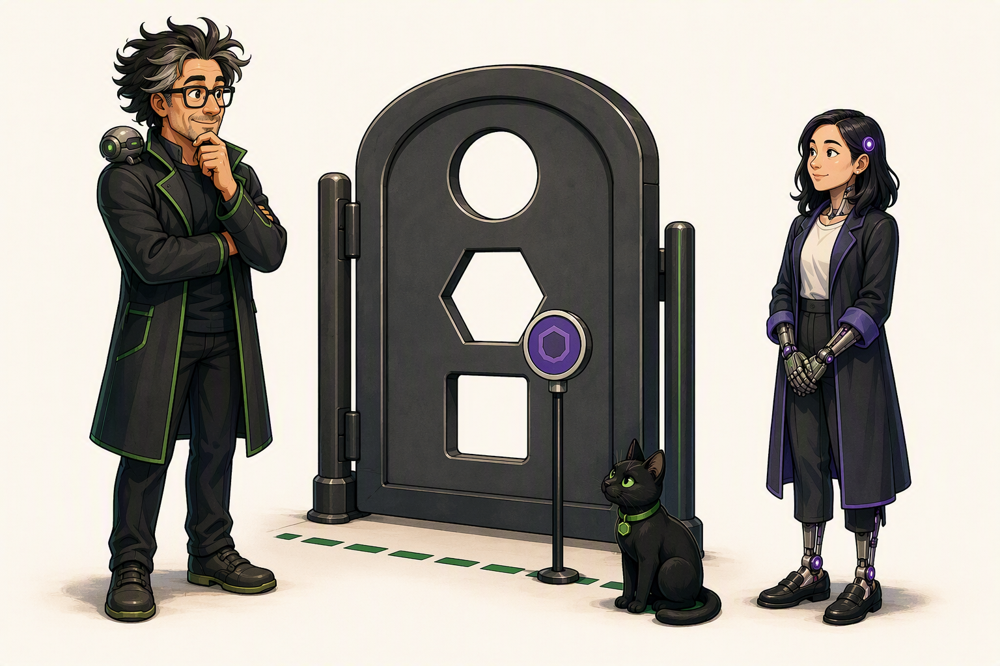

Amber action token paused at Purrmission's gate until Mergewell decides

<h2>Proof 3: Behavioral &amp; Negative-Test Evidence</h2>

"All tests pass" is meaningless if the suite only tests happy paths—or if the agent weakened the test to get green.

<ul class="tok-list tok-list--small" style="margin:0">
<li><strong>Require a named negative test:</strong> e.g., <em>"Unauthenticated request to /api/export returns 403."</em></li>
<li><strong>Verify test integrity:</strong> Confirm existing assertions were not deleted, .skipped, or mocked out.</li>
</ul>

<h2>Proof 4: Hard Stop Conditions (Pause &amp; Ask)</h2>

Like the amber token stopped at Purrmission's gate on the left, the plan must name when Riley <strong>stops immediately</strong>:

<ul class="tok-list tok-list--small" style="margin:0">
<li>Adding or upgrading any package in package.json / pnpm-lock.yaml</li>
<li>Adding eslint-disable, @ts-ignore, or CodeQL suppression comments</li>
<li>Changing auth scopes, CORS origins, CSP headers, or environment variables</li>
</ul>

Sources: PLAN-04, PLAN-05; SEC-03, OPT-01 · reviewed 2026-10-19.

<!--
Timebox: 3 minutes

Talk track: Look at the illustration on the left. Riley Relay has reached a consequential boundary with an amber token, and Purrmission is sitting right on the threshold line while Mergewell evaluates the gate. That is what Proofs 3 and 4 look like in practice. Proof 3 says: do not tell me "tests pass." Tell me which negative security test proves an attacker or unauthorized caller gets blocked, and show me in the diff that you didn't delete or weaken existing test assertions to make the build green. Proof 4 defines Hard Stop Conditions. An agent without stop conditions will try to be helpful in the worst possible way: if a linter or security rule blocks its code, it might add an ignore comment; if a helper is missing, it might install an unvetted npm package. When you state these four stop triggers in the plan, the agent knows that hitting any of them means "pause and ask Mergewell."

Transition: Let us put all four planning proofs together into a single two-minute Pre-Flight Planning Audit you can copy into your workflow tomorrow.

Audience question: What is one "helpful improvisation" you never want an agent to make without asking you first?

Response guidance: Common answers include editing database migrations, changing CI permissions, or disabling type checks. Add those straight to your team's stop-condition list.

Payoff: You can specify concrete negative tests and four non-negotiable stop conditions before an agent executes.

Sources: PLAN-04, PLAN-05; SEC-03, OPT-01 · reviewed 2026-10-19. Art: approved approval-boundary-gate.png; see its provenance sidecar.
-->

---
layout: default
class: tok
---

# The Pre-Flight Planning Audit: Trust, Verify, Then Execute

<nav class="tok-chips" data-on="2">HookPlanningHarnessVuln LensesGovernanceSlip</nav>

Turn a wishful prompt into an evidence-backed Plan Contract in 30 seconds.

<table class="tok-table">
<thead>
<tr>
<th style="width:20%">Dimension</th>
<th style="width:36%">Vague Prompt (Avoid)</th>
<th style="width:44%">Evidence-Backed Plan Contract (Do)</th>
</tr>
</thead>
<tbody>
<tr class="is-avoid">
<td><strong>1. Scope</strong></td>
<td>"Fix the tenant export bug securely."</td>
<td>Do Edit only src/export/handler.ts + test. <strong>No-touch:</strong> src/auth/**, lockfile, CI.</td>
</tr>
<tr class="is-watch" v-click>
<td><strong>2. Rules</strong></td>
<td><em>(Assumes repo rules load)</em></td>
<td>Do Verify security.instructions.md in /instructions &amp; cite active rules.</td>
</tr>
<tr class="is-do" v-click>
<td><strong>3. Proof</strong></td>
<td>"Run tests when done."</td>
<td>Do Add negative test proving Tenant A → Tenant B export returns 403.</td>
</tr>
<tr class="is-do" v-click>
<td><strong>4. Stops</strong></td>
<td>"Fix any errors you hit."</td>
<td>Stop Pause &amp; ask before adding packages, suppressions, or auth edits.</td>
</tr>
</tbody>
</table>

<strong>Habit:</strong> Separate <strong>Research → Plan → Implement</strong>. Review the route map before Riley writes code.

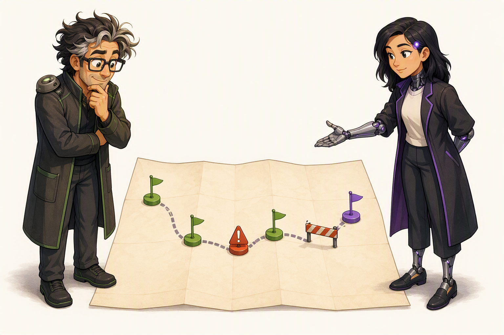

Riley proposes the 4-waypoint route · Mergewell verifies before action

Sources: PLAN-01..05; OPT-01 section 6 · reviewed 2026-10-19.

<!--
Timebox: 2 minutes

Talk track: Here is the side-by-side difference between hoping an agent behaves and engineering a verifiable plan. Look at the middle column: "Fix the tenant export endpoint and make sure it's secure. Run tests when done." That is how 90% of prompts look in the wild, and it gives you zero baseline to audit against. Now look at the right column. In four short lines, you have locked the allowed files and the no-touch files, required the agent to confirm which instruction file loaded, named the exact cross-tenant 403 negative test that must pass, and set the stop triggers. Separating Research, Plan, and Implement doesn't slow you down—it prevents the agent from sprinting two miles in the wrong direction.

Transition: Once the plan is locked and Riley begins executing, what keeps her safe inside the workspace? Welcome to Act III: the Copilot Harness.

Audience question: If you require an agent to write this four-row plan before editing files, how long does it take to review?

Response guidance: Emphasize "under thirty seconds." Reviewing four lines of scope and negative-test intent before execution saves thirty minutes of untangling a bad diff later.

Payoff: Participants have a concrete four-row template to audit any agent plan before execution starts.

Sources: PLAN-01..05; OPT-01 section 6 · reviewed 2026-10-19.
-->

---
layout: default
class: tok
---

# Inside the Copilot Harness: Four Rings Around the Model

<nav class="tok-chips" data-on="3">HookPlanningHarnessVuln LensesGovernanceSlip</nav>

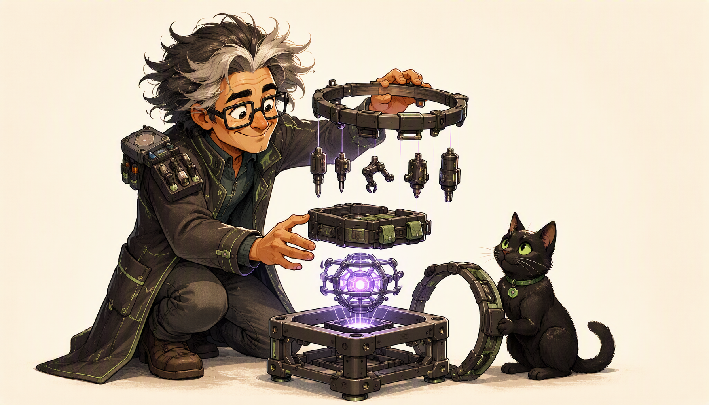

Mergewell configures the harness · Purrmission's paw holds the outer guardrail ring

A model only predicts tokens. The <strong>harness</strong> turns predictions into governed work.

<b>1. Instructions Ring</b>
Repo copilot-instructions.md and scoped .instructions.md files that set security standards.

<b>2. Tools &amp; MCP Ring</b>
Built-in search/edit tools and MCP servers that define what the agent can read or invoke.

<b>3. Execution &amp; Isolation Ring</b>
A worktree alone is not a sandbox; verify the runtime and any configured container restrictions.

<b>4. Guardrails Ring</b>
Configured tool approvals and branch rules; content exclusions and credit limits are not universal runtime barriers.

<strong>Key Distinction:</strong> Instructions guide behavior; enforcement depends on the configured control and execution surface.

Sources: HARN-01; SEC-01, SEC-02, SEC-03, SEC-11, SEC-18 · reviewed 2026-10-23.

<!--
Timebox: 3 minutes

Talk track: When people talk about AI safety in software engineering, they often talk as if the model is floating in a vacuum. It isn't. Look at Mergewell and Purrmission on the right. The first ring is Instructions: standards we want the model to follow. The second is Tools and MCP: capabilities available in the session. The third is the execution workspace and any actual isolation. A Git worktree separates working copies; it does not restrict process permissions, host files, credentials, or network access. Call an environment a sandbox only when a restricted runtime or container is explicitly configured, and verify its real limits. The fourth ring is Guardrails: configured tool approvals and repository rules. Content exclusions vary by surface, and AI-credit session limits are soft cost controls—not runtime permission gates.

Transition: Let us look at the single most important security principle inside that harness: Least-Privilege Keys.

Audience question: Why can we never rely on the Instructions Ring alone to prevent an agent from running a destructive command?

Response guidance: Reinforce that instructions are probabilistic context, whereas tool availability and confirmation gates in the Guardrails Ring are deterministic enforcement.

Payoff: You can distinguish a workspace from configured isolation and separate behavioral guidance from enforceable controls.

Sources: HARN-01; SEC-01..03, SEC-11 Content exclusion, SEC-18 Git worktree · reviewed 2026-10-23. Art: approved copilot-harness-guard.png; see its provenance sidecar.
-->

---
layout: default
class: tok
---

# Least-Privilege Keys: Scoping Tools, MCP, and Runtime Access

<nav class="tok-chips" data-on="3">HookPlanningHarnessVuln LensesGovernanceSlip</nav>

Hand the agent one small green task key; keep Purrmission's paw on the master key ring.

<table class="tok-table">
<thead>
<tr>
<th>Surface</th>
<th>Least-Privilege Practice</th>
<th>Security &amp; Context Payoff</th>
</tr>
</thead>
<tbody>
<tr class="is-do">
<td><strong>MCP Servers</strong></td>
<td>Do Enable only the MCP servers needed for this task; prefer read-only tools.</td>
<td>Shrinks blast radius and saves tool-schema tokens on every turn.</td>
</tr>
<tr class="is-watch" v-click>
<td><strong>Shell &amp; Network</strong></td>
<td>Watch Keep human confirmation active for destructive shell or network calls.</td>
<td>Stops unintended rm, git push --force, or external calls.</td>
</tr>
<tr class="is-do" v-click>
<td><strong>AI Credit Limit</strong></td>
<td>Do Set /limits set max-ai-credits N (min 30, soft cap) in CLI.</td>
<td>Cost control only: a current response may finish over the cap; it does not restrict permissions.</td>
</tr>
<tr class="is-avoid" v-click>
<td><strong>Master Secrets</strong></td>
<td>Avoid Never pass admin PATs or prod DB write keys into an agent shell.</td>
<td>An agent can never leak or misuse a key it does not possess.</td>
</tr>
</tbody>
</table>

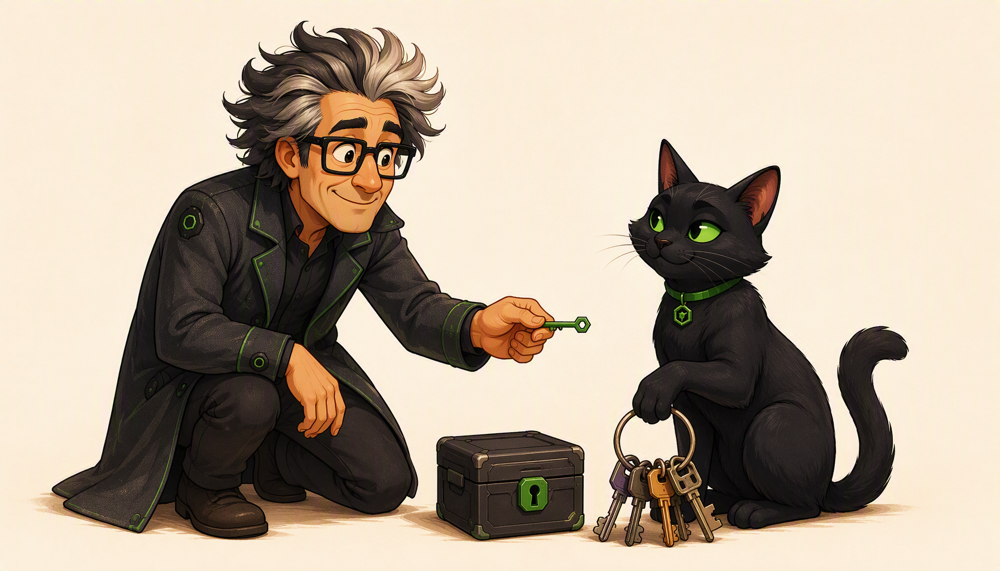

One scoped green key for the task · Purrmission's paw on the master ring

Sources: HARN-02; SEC-02, SEC-03, SEC-13 · reviewed 2026-10-23.

<!--
Timebox: 3 minutes

Talk track: Mergewell hands one small green key to a bounded task case. Purrmission keeps her paw on the oversized master key ring. In practice, least privilege means enabling only needed MCP servers, configuring appropriate approval gates for consequential tools, and keeping broad credentials out of the agent's environment. A CLI AI-credit session limit can help control cost, but it is a soft cap: an in-progress response can finish above it. It is not a security boundary and does not limit filesystem, network, or tool permissions.

Transition: Why is keeping Purrmission's paw on that master key ring so critical? Because of what happens when untrusted text enters the context window.

Audience question: What happens if you leave twenty MCP servers enabled with write permissions during a routine bug-fix session?

Response guidance: Note the dual penalty: every enabled tool schema consumes context window space on every turn, AND any prompt injection now has twenty write-capable tools to choose from.

Payoff: Participants know how to scope MCP tools, shell approvals, environment credentials, and CLI session caps.

Sources: HARN-02; SEC-02 MCP in Copilot Chat; SEC-03 Copilot CLI; SEC-13 AI credit session limits · reviewed 2026-10-23. Art: approved least-privilege-paw.png; see its provenance sidecar.
-->

---
layout: default
class: tok
---

# AI Safety in the Wild: Prompt Injection and Context Drift

<nav class="tok-chips" data-on="3">HookPlanningHarnessVuln LensesGovernanceSlip</nav>

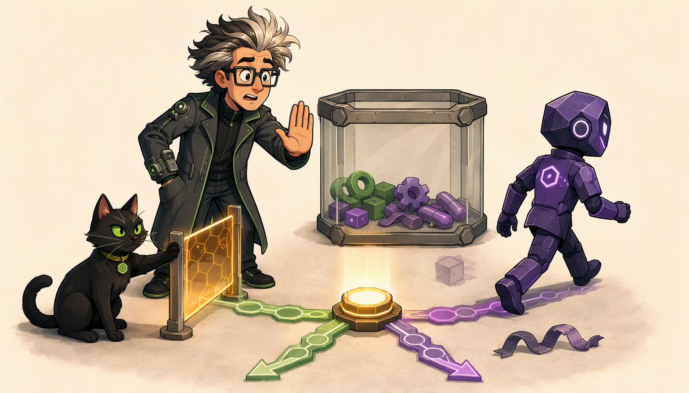

Purrmission drops the amber gate across the drifting path before execution

Untrusted content in the context window is data—never let it become a command.

<h2>Threat A: Indirect Prompt Injection</h2>
<ul class="tok-list tok-list--small" style="margin:0">
<li>Reading an untrusted issue body, PR comment, or external web page brings adversarial text into the context window alongside your instructions.</li>
<li><strong>Defense:</strong> Isolate untrusted reads from write tools, never auto-approve arbitrary shell/network calls, and inspect tool arguments at Purrmission's gate.</li>
</ul>

<h2>Threat B: Context Drift Is Not Cache Invalidation</h2>
<ul class="tok-list tok-list--small" style="margin:0">
<li>Long or conflicting history and compaction can make earlier constraints less available. Cache misses reprocess context; they do not erase instructions.</li>
<li><strong>Defense:</strong> When answers drift, pause; restate and verify the plan, inspect context, or start a <strong>fresh session</strong>.</li>
</ul>

Sources: HARN-03, HARN-04; SEC-02, SEC-12, OPT-01 sections 3, 4, 7 · reviewed 2026-10-23.

<!--
Timebox: 2 minutes

Talk track: Let us connect AI safety to day-to-day engineering. First is indirect prompt injection: an issue or web page can contain adversarial text alongside your instructions. Treat it as data, limit the tools available, and require configured approval before consequential actions. Those controls reduce risk; they do not make every attack impossible. The second threat is context drift. Long or conflicting history and compaction can make earlier constraints less available. Keep tasks focused, check active context, and restate critical rules. Cache invalidation is separate: it can cause context to be processed again and affect cost, but does not itself delete instructions.

Transition: Now Riley has finished her work inside a tight harness and returns her evidence folio to the desk. How do we hunt for vulnerabilities before anything merges? Welcome to Act IV.

Audience question: Why is "Summarize this external issue AND deploy the fix" a dangerous single-turn prompt?

Response guidance: Point out that it combines an untrusted data source (external issue text) with high-privilege write/deploy tools in the exact same turn without a human checkpoint in between.

Payoff: You can identify untrusted input, use configured action boundaries, and distinguish context drift from cache cost.

Sources: HARN-03, HARN-04; SEC-02, SEC-12 Context management, OPT-01 · reviewed 2026-10-23.
-->

---
layout: default
class: tok
---

# Four Security Evidence Lenses: Why One Scan Never Suffices

<nav class="tok-chips" data-on="4">HookPlanningHarnessVuln LensesGovernanceSlip</nav>

Pair probabilistic AI review with deterministic GitHub Advanced Security (GHAS).

<b>Lens 1: On-Demand /security-review</b>
Pre-PR agentic inspection of staged/unstaged diffs for contextual logic and exploitable paths.

<b>Lens 2: Secret Push Protection</b>
When enabled, blocks detected supported patterns before repository acceptance; configured bypasses remain possible.

<b>Lens 3: GHAS CodeQL &amp; Dependency Review</b>
Configured CodeQL and Dependency Review checks provide evidence within their supported, selected scope.

<b>Lens 4: Copilot Code Review + Autofix + Human</b>
PR-level AI review and targeted remediation proposals—verified by CI and accepted by Mergewell.

<strong>Why four lanes?</strong> They have different strengths and blind spots. A green status proves configured checks passed—not that every risk was covered.

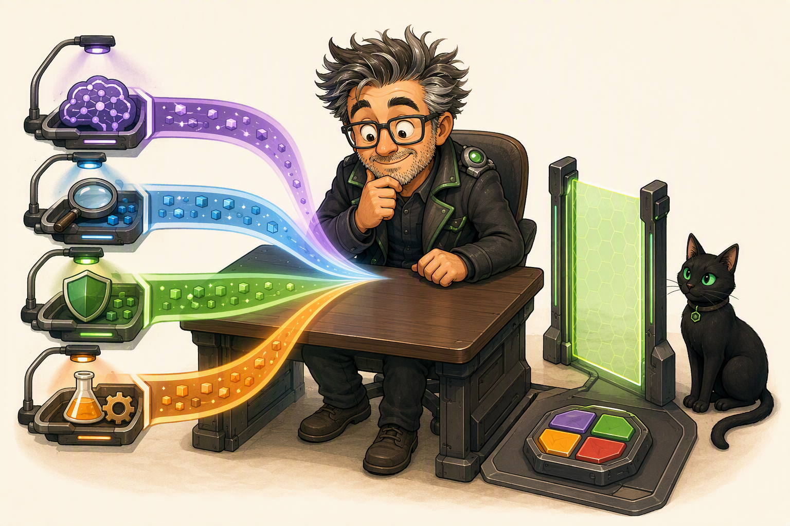

Four independent evidence streams converge under Mergewell's lens

Sources: VULN-01; SEC-04..08, SEC-14..16 · reviewed 2026-10-23.

<!--
Timebox: 3 minutes

Talk track: Look at the desk in front of Mergewell and Purrmission. Four evidence lanes arrive at the review table. Why do we need more than one? AI review can reason about intent and business logic, but can miss issues. Configured GitHub security checks apply repeatable rules, but their results are limited by what is enabled and supported. CodeQL scope depends on the analyzed languages, query suite, database extraction, and available framework/data-flow models. Dependency Review evaluates the dependency changes its workflow is configured to check. Push Protection targets supported patterns and can be bypassed under policy. A passing status is useful evidence about those checks; it is not proof that every line, package, or risk is clean.

Transition: Let us walk through Lenses 1 and 2 first—what happens before a pull request is even opened or pushed.

Audience question: If CodeQL is green, why do we still need a contextual review—and if Copilot Code Review says "no issues found," why do we still need CodeQL?

Response guidance: Summarize the complementarity: static rules prove known vulnerability patterns and data-flow sinks are clean; contextual review checks domain logic; human review owns the architecture.

Payoff: Participants can explain what each lane contributes and why a passing check is scoped evidence, not a security guarantee.

Sources: VULN-01; SEC-04..08, SEC-14 CodeQL, SEC-15 Push protection, SEC-16 supported patterns · reviewed 2026-10-23. Art: approved evidence-streams-desk.png; see its provenance sidecar.
-->

---
layout: default
class: tok
---

# Shift-Left Vulnerability Hunting: `/security-review` and Push Protection

<nav class="tok-chips" data-on="4">HookPlanningHarnessVuln LensesGovernanceSlip</nav>

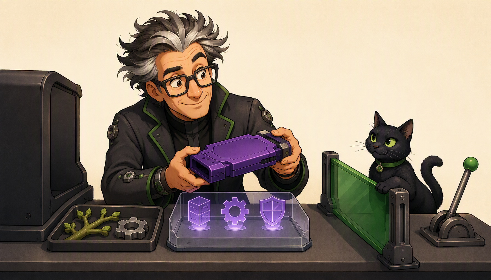

Inspect local changes; block detected supported secrets before repository acceptance

<h2>Lens 1: On-Demand /security-review Before the PR</h2>
<ul class="tok-list tok-list--small" style="margin:0">
<li>Run a dedicated read-only /security-review on your staged/branch diff before opening a PR.</li>
<li><strong>CRITICAL / HIGH findings</strong> (SQLi, SSRF, auth bypass, path traversal): block locally, fix, and add a negative test.</li>
<li><strong>Independent context:</strong> A fresh reviewer agent isn't biased by the builder agent's thread.</li>
</ul>

<h2>Lens 2: Secret Scanning Push Protection</h2>
<ul class="tok-list tok-list--small" style="margin:0">
<li>Agents sometimes copy or generate a live token, webhook URL, or key into a test fixture or config file.</li>
<li><strong>If a secret reaches remote history:</strong> Removing it in a later commit is not enough; revoke or rotate the credential.</li>
<li><strong>Push Protection:</strong> When enabled, blocks detected supported patterns before repository acceptance. Bypass is possible.</li>
</ul>

Sources: VULN-02, VULN-03; SEC-08, SEC-15, SEC-16 · reviewed 2026-10-23.

<!--
Timebox: 3 minutes

Talk track: Look at Mergewell and Purrmission at the terminal bench. First is Lens 1: run an on-demand `/security-review` against the change to look for exploitable paths before opening a PR. It is an agent review, so inspect and verify its findings. Second is Lens 2: GitHub Secret Scanning Push Protection. When enabled, it can block detected supported secret patterns before the repository accepts a push. Detection coverage is not universal, and configured bypasses can allow a push. A successful push is not proof that no secret was present. If a real credential reaches remote history, revoke or rotate it; deleting it in a later commit does not undo exposure.

Transition: Once your local diff is clean and your push succeeds, Lenses 3 and 4 take over on the pull request: CodeQL, Dependency Review, Copilot Code Review, and Autofix.

Audience question: Why is deleting a leaked token in a second commit ("oops, removed key") never enough once the first commit was pushed?

Response guidance: Confirm that git preserves every prior commit blob in history; anyone with read access to the repo or fork history can read the first commit. Only blocking at push time prevents exposure.

Payoff: You can pair pre-PR review with configured Push Protection and explain its detection and bypass limits.

Sources: VULN-02, VULN-03; SEC-08, SEC-15, SEC-16 · reviewed 2026-10-23. Art: approved cli-controlled-action.png; see its provenance sidecar.
-->

---
layout: default
class: tok
---

# Deterministic GHAS + Copilot Code Review and Autofix

<nav class="tok-chips" data-on="4">HookPlanningHarnessVuln LensesGovernanceSlip</nav>

Deterministic scanners find the proof; AI accelerates the fix; humans own the merge.

<h2>Lens 3: CodeQL &amp; Dependency Review (Deterministic)</h2>
<ul class="tok-list tok-list--small" style="margin:0">
<li><strong>CodeQL Code Scanning:</strong> Queries a code database for flows from untrusted input (<em>source</em>) to dangerous execution (<em>sink</em>) within configured, supported languages and query scope.</li>
<li><strong>Dependency Review:</strong> Checks configured dependency changes in supported manifests/lockfiles against the selected policy; verify the check actually ran.</li>
</ul>

<h2>Lens 4: Copilot Code Review &amp; Autofix (Bounded AI)</h2>
<ul class="tok-list tok-list--small" style="margin:0">
<li><strong>Copilot Code Review + Autofix:</strong> Reviews the PR diff for logic flaws and proposes targeted patches for CodeQL alerts in seconds.</li>
<li><strong>The Handoff Rule:</strong> Like Riley handing her 3-part folio to Mergewell on the right, an Autofix is still a proposal—re-run CodeQL/tests and review before merging.</li>
</ul>

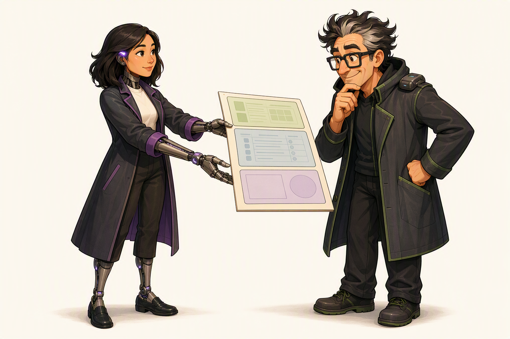

Riley hands over the 3-part PR evidence folio · Mergewell owns acceptance

Sources: VULN-04, VULN-05; SEC-05, SEC-07, SEC-08, SEC-14 · reviewed 2026-10-23.

<!--
Timebox: 4 minutes

Talk track: Now we are on the pull request, where Lenses 3 and 4 work side by side. CodeQL creates a database and runs configured queries for supported languages. Its evidence depends on extraction, query selection, and available models for frameworks and data flow. A green result does not prove every language, line, or sink was analyzed or that the code is secure. Dependency Review evaluates the dependency changes its workflow is configured to inspect; verify that it ran and review its policy and findings. Copilot Code Review can add contextual feedback, and Autofix can propose a remediation for an alert. Treat every proposal as unverified: review the diff, rerun the configured checks and tests, and confirm the behavior yourself.

Transition: We have verified the plan, locked the harness, and cleared all four vulnerability lenses. How does an organization make sure nobody skips these steps when a deadline looms? Welcome to Act V: Governance and Deployment Guardrails.

Audience question: When Copilot Autofix suggests a patch for a CodeQL alert, what two checks must happen before you consider that alert resolved?

Response guidance: Look for: (1) deterministic CodeQL re-scan + CI test suite passing on the new commit, and (2) human review confirming the fix didn't break business logic or downstream callers.

Payoff: Participants can articulate how CodeQL, Dependency Review, Copilot Code Review, and Copilot Autofix interlock on every pull request.

Sources: VULN-04, VULN-05; SEC-05 Responsible use of Copilot Autofix; SEC-07 Dependency review; SEC-08; SEC-14 CodeQL · reviewed 2026-10-23.
-->

---
layout: default
class: tok
---

# Enterprise Governance: Rulesets, Policy, and Auditability

<nav class="tok-chips" data-on="5">HookPlanningHarnessVuln LensesGovernanceSlip</nav>

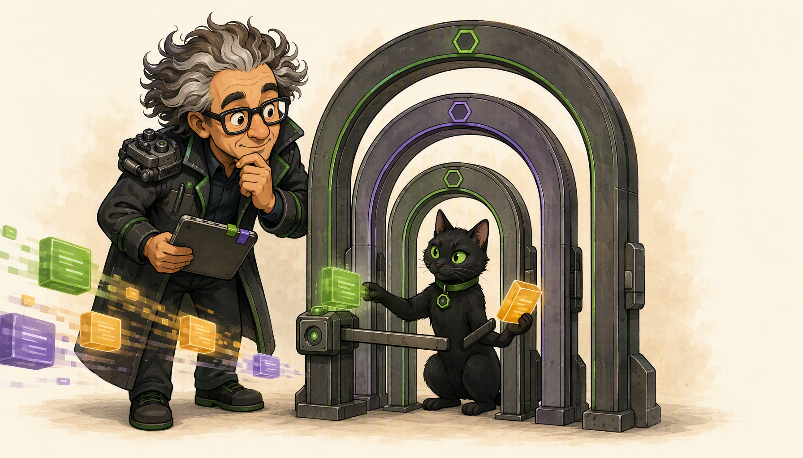

Three nested governance archways · Purrmission holds unverified work at the gate

Individual discipline scales only when backed by structural archways.

<table class="tok-table">
<thead>
<tr><th>Governance Layer</th><th>Control Surface</th><th>What It Enforces</th></tr>
</thead>
<tbody>
<tr class="is-do">
<td><strong>Repo Rulesets</strong></td>
<td>Ruleset requirements: PRs, checks, and named bypass actors</td>
<td>Enforces configured requirements; restrict and audit bypass permissions.</td>
</tr>
<tr class="is-do" v-click>
<td><strong>Human Sign-Off</strong></td>
<td>CODEOWNERS + <strong>Require review from Code Owners</strong></td>
<td>Applies to covered paths; required reviews and bypass permissions must be configured.</td>
</tr>
<tr class="is-watch" v-click>
<td><strong>Copilot &amp; MCP Policy</strong></td>
<td>Org/Enterprise model policy, MCP allowlists, content exclusions</td>
<td>Governs configured models/tools; exclusions are surface-limited, not runtime filesystem controls.</td>
</tr>
<tr class="is-watch" v-click>
<td><strong>Separate Meters</strong></td>
<td><strong>GitHub AI Credits</strong> vs. <strong>Actions minutes</strong></td>
<td>AI tokens consume AI credits; CI/CodeQL runners consume Actions minutes.</td>
</tr>
</tbody>
</table>

Sources: GOV-01..03; SEC-09, SEC-11, SEC-17, SRC-02 · reviewed 2026-10-23.

<!--
Timebox: 3 minutes

Talk track: Look at the nested governance archways. Rulesets enforce only the requirements administrators configure, such as requiring a pull request or named status checks; check which actors can bypass those rules. A `CODEOWNERS` file requests review for paths it covers, but that file alone does not require approval. Enable **Require review from Code Owners** in branch protection or the ruleset, then verify its path coverage and bypass settings. Organization and enterprise policies can govern models and MCP access. Content exclusions are surface-specific; for example, they do not apply in VS Code Agent or Edit modes, so do not treat them as filesystem isolation. Keep the meters distinct too: AI model usage and Actions runner compute are separate.

Transition: Once a pull request clears every archway and merges, there is one final threshold left: promoting that exact code into production.

Audience question: Why should Copilot Code Review be configured as an automatic check on pull requests, yet never count as the sole required approval to merge?

Response guidance: Because Copilot Code Review provides fast, high-value feedback early, but an AI reviewer cannot hold legal, operational, or on-call accountability for production.

Payoff: Leads and developers can distinguish configured enforcement from advisory policy and verify where human review applies.

Sources: GOV-01..03; SEC-09 Rulesets; SEC-11 Content exclusion; SEC-17 Code Owner rules and bypass; SRC-02 Models and pricing · reviewed 2026-10-23. Art: approved enterprise-archways.png; see its provenance sidecar.
-->

---
layout: default
class: tok
---

# Guardrails to Production: Exact-Commit Promotion and Rollback

<nav class="tok-chips" data-on="5">HookPlanningHarnessVuln LensesGovernanceSlip</nav>

Never deploy "whatever is on the branch." Promote the exact commit you proved.

1. Private Test<i>→</i>2. Pin Commit SHA<i>→</i>3. Human Gate<i>→</i>4. Verify &amp; Rollback

<h2>Exact-Commit Promotion</h2>
<ul class="tok-list tok-list--small" style="margin:0">
<li>Validate in a private test environment first, then pin the exact <strong>40-character commit SHA</strong> in the release manifest.</li>
<li>Unrelated later merges on main cannot sneak into your production promotion while awaiting human environment approval.</li>
</ul>

<h2>Automated Verification &amp; Instant Rollback</h2>
<ul class="tok-list tok-list--small" style="margin:0">
<li>Post-deploy verification is <strong>automated evidence</strong> (route checks, health probes, provenance match), and the prior verified SHA stays ready for one-command rollback.</li>
</ul>

Locked release lever · Purrmission guards the single commit-pinned release key

Sources: GOV-04; SEC-10 · reviewed 2026-10-19.

<!--
Timebox: 3 minutes

Talk track: Look at Mergewell and Purrmission on the left. The release lever is physically locked, Purrmission sits beside the single matching green release key, and Mergewell is still inspecting the blueprint with his magnifying lens. Why? Because the most subtle deployment bug in fast-moving teams is the "moving branch" trap: you review commit A in staging, someone else merges an agent PR (commit B) onto main five minutes later, and your production deploy pipeline ships commit B by mistake. Safe deployment guardrails pin the exact 40-character commit SHA that passed test verification. When Mergewell approves the production environment gate, the workflow exports and deploys that exact commit—nothing newer, nothing unreviewed. Immediately after deploy, automated route and provenance checks verify the live site, and the previous verified manifest stays ready as an instant, exact-commit rollback target.

Transition: We have traveled all the way from a Thursday afternoon prompt to a commit-pinned production release. Let us close by handing everyone in the room their Monday-morning Purrmission Slip.

Audience question: What happens to your audit trail if your deployment script pulls the tip of a branch instead of a pinned commit SHA?

Response guidance: Point out that you can no longer prove which exact code scanning run, test run, or human review corresponds to the bytes running in production.

Payoff: You can design a deployment gate that promotes only an exact reviewed commit SHA with automated post-deploy verification and instant rollback.

Sources: GOV-04; SEC-10 Configuring environments for deployment · reviewed 2026-10-19. Art: approved human-release-key.png; see its provenance sidecar.
-->

---
layout: default
class: tok
---

# Your Purrmission Slip: The 5-Point Evidence Checklist

<nav class="tok-chips" data-on="6">HookPlanningHarnessVuln LensesGovernanceSlip</nav>

All 5 proofs verified → Purrmission sleeps soundly on her warm cushion stack

"Polite words from an agent are not evidence. Verify the proof—then proceed."

<b>1. Plan &amp; Scope Proof</b>
Compare the recorded base to HEAD; inspect committed, staged, unstaged, and every untracked path.

<b>2. Instruction &amp; Context Proof ("Saved ≠ Loaded")</b>
Security instructions are verified as active via /instructions, /context, or the Chat <strong>References</strong> list.

<b>3. Negative Test &amp; Harness Proof</b>
Least-privilege tools/MCP are scoped, stop triggers were respected, and a named <strong>negative security test</strong> passes.

<b>4. Four-Lens Vulnerability Proof</b>
Review configured scan scope and results; triage alerts and any Push Protection bypasses.

<b>5. Human Governance &amp; Exact-Commit Proof</b>
Required Code Owner approval covers the changed paths; inspect bypass settings and promote the <strong>exact verified commit SHA</strong>.

Sources: PLAN-01..05, HARN-01..04, VULN-01..05, GOV-01..04; SEC-11..18 · reviewed 2026-10-23.

<!--
Timebox: 2 minutes

Talk track: Here is your takeaway for Monday morning: the five-point Purrmission Slip. One: compare the recorded review base to HEAD, inspect the committed patch, staged and unstaged changes, and every untracked file; do not rely on status or a summary alone. Two: verify that security instructions loaded. Three: use least-privilege tools, verify any actual isolation, respect configured approval gates, and pass a named negative test. Four: inspect which security checks ran and what they covered; triage findings and any Push Protection bypasses. A green CodeQL or Dependency Review status is scoped evidence, not a guarantee. Five: confirm the required human review applies to the changed paths, check who can bypass it, and promote the exact verified commit SHA. When the evidence supports the decision, Mergewell can proceed.

Transition: Open the floor for final questions or invite participants to pick the one check they will add to their team's workflow this week.

Audience question: Which of the five checks on the Purrmission Slip are you going to try on your very next agent-assisted pull request?

Response guidance: Celebrate specific commitments—especially checking References / /instructions for loaded rules, adding a no-touch file list to plans, or running /security-review before opening a PR.

Payoff: Every developer, reviewer, and lead leaves with a portable five-point security verification habit from planning to deployment.

Sources: PLAN-01..05, HARN-01..04, VULN-01..05, GOV-01..04; SEC-11..18 · reviewed 2026-10-23. Art: approved purrmission-star-alert.png; see its provenance sidecar.
-->
