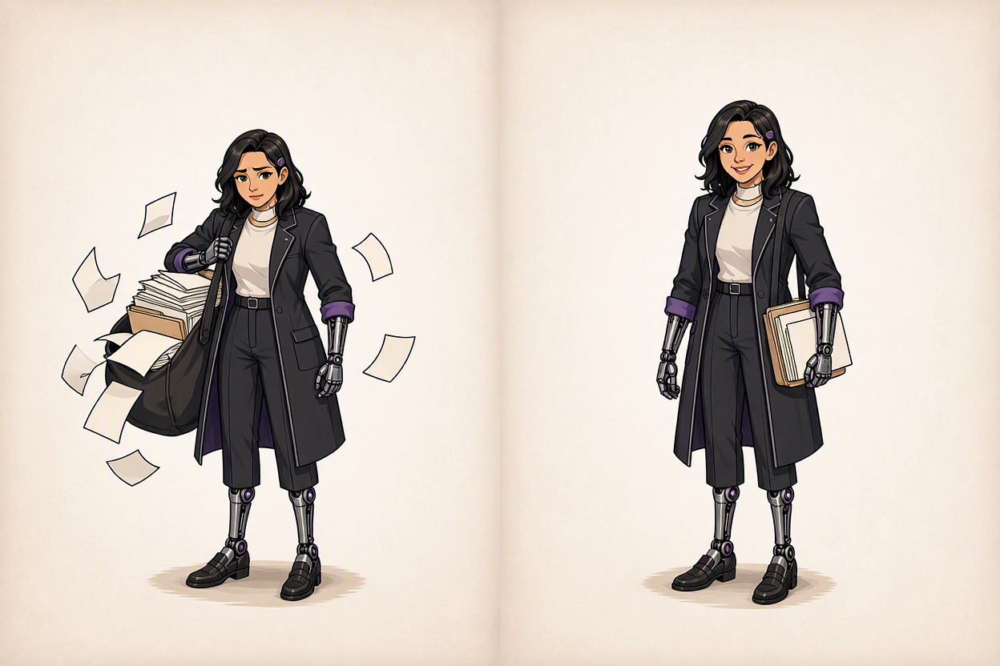

# Token Optimization

<section class="tok-grid tok-grid--intro">

GitHub Copilot · Developers, leads, and admins

Lean context. Warm cache. Right model. Verified results.

Spend every GitHub AI Credit on progress you can check.

</section>

<!--
Timebox: 1 minute

Talk track: Introduce the session as Token Optimization. The aim is simple: spend each GitHub AI Credit on progress you can verify. Name the four ideas on the subheading, lean context, warm cache, right model, and verified results, and tell the room that the next hour is organized around them. Welcome both audiences: developers who will leave with habits and leads and admins who will leave with controls.

Transition: Next we set out the route and the measure of success.

Audience question: Who here has watched a Copilot session use more than you expected?

Response guidance: Take a show of hands only. Say, "We will map that to a cause by the end."

Payoff: The room knows the topic, the four ideas, and the two audiences before any detail.

Sources: requirements.md Governing aim (no time-sensitive claims on this slide). Art: approved workflow-team-shallow-depth-v7, reused unchanged; see its provenance sidecar.
-->

---
layout: default
class: tok
---

# Token Optimization: Opening

Get more verified progress from every GitHub AI Credit.

Copilot is a harness. What it sends, which model runs, and how you shape the work drive consumption.

Tokens<i>→</i>Context<i>→</i>Cache

Model<i>→</i>Workflow<i>→</i>Measure and cap

<h2>For developers</h2>
CLI-led habits, with VS Code callouts where the surface differs.

<h2>For leads and admins</h2>
Budgets, model policy, and review-effort settings.

<strong>Success is useful, verified progress, not the fewest credits.</strong> An unverified cheaper response is not progress.

<!--
Timebox: 1 minute

Talk track: Name the aim: Copilot is a harness that assembles context, uses a model, and runs a workflow, and cost follows from those three. We move left to right across the strip, from tokens to measuring and capping. Developers get habits for this week; leads and admins get controls. The CLI leads, with VS Code callouts.

Transition: First, why does any of this matter now? Because Copilot usage is metered in a specific unit.

Audience question: What is one thing that has surprised you about how much a Copilot session consumed?

Response guidance: Take one or two quick answers without debugging them. Say, "Hold that thought; we will map it to a cause by the end."

Payoff: Participants know the route, the two audiences, and the success measure before any detail.

Sources: requirements.md Governing aim and Required route (no time-sensitive claims on this slide).
-->

---
layout: default
class: tok
---

# Why Tokens Matter Now: GitHub AI Credits

<nav class="tok-chips" data-on="1">TokensContextCacheModelWorkflowControl</nav>

<h2>What the unit measures</h2>

Model × tokens → AI credits

<ul class="tok-list"><li>Interaction cost depends on the model and on input, output, and cached tokens.</li><li>That cost is converted into <strong>GitHub AI Credits</strong>, called AI credits from here on.</li><li>Not "premium requests": that was the earlier request-based label. A legacy annual plan may still show it.</li></ul>

<h2>What can and cannot consume them</h2>
<ul class="tok-list"><li><strong>Can consume:</strong> Chat, CLI, cloud agent, Spaces, Spark, and third-party coding agents.</li><li><strong>Not billed in AI credits on paid plans:</strong> code completions and next edit suggestions.</li></ul>

AI credits are a different meter from <strong>GitHub Actions minutes</strong> and other product meters. Do not convert one into the other.

Why now: the unit is token-based, so what the harness sends and which model answers become engineering decisions.

Sources: CREDIT-01, CREDIT-02, CREDIT-09; SRC-02, SRC-04 · reviewed 2026-10-09 · applies to paid plans; allowances and rates vary by plan and are not shown here.

<!--
Timebox: 3 minutes

Talk track: Copilot usage is measured in GitHub AI Credits. Say it fully once, then AI credits. The cost of an interaction depends on the model and on the tokens: input, output, and cached. Those are converted into credits. Several surfaces can consume them, including Chat, the CLI, the cloud agent, Spaces, Spark, and third-party coding agents. On paid plans, code completions and next edit suggestions are not billed in AI credits. A participant on an older annual plan may still see request-based terms, so acknowledge that rather than claiming every account has moved. Finally, keep the meters separate. A Copilot code review, for example, consumes AI credits for model tokens and also consumes GitHub Actions minutes for the infrastructure. A targeted test run that saves Actions minutes is not an AI-credit formula. We show no prices or allowances in this session because they change and vary by plan. Concrete example to use: imagine two teammates fix the same small bug. One opens a fresh chat, names the file, and states what done looks like. The other continues a long thread that began with an unrelated refactor, then pastes in a stack trace. The first request is small and focused. The second carries the earlier conversation into every new request as input.

Transition: If cost is model times tokens, we need to know exactly what a token is and what goes into one request.

Audience question: Which of your team's Copilot activities are metered in AI credits, and which are not? Follow-up if the room is quiet: when a code review runs on a pull request, which two meters might it touch? Let people answer, then confirm: AI credits for model tokens, and Actions minutes for the infrastructure.

Response guidance: Steer toward chat, CLI, and agents as metered and completions as not metered on paid plans. If someone cites older terms, say, "That is the earlier request-based label. Check what your account shows."

Payoff: You can state the unit, what drives it, and that Actions minutes are a separate meter.

Sources: CREDIT-01, CREDIT-02, CREDIT-09; SRC-02 Models and pricing; SRC-04 Usage-based billing for individuals; all reviewed 2026-10-09.
-->

---
layout: default
class: tok
---

# Tokens: What Enters the Model

<nav class="tok-chips" data-on="1">TokensContextCacheModelWorkflowControl</nav>

The harness decides what is sent. Only what is actually included can influence the next prediction.

<b>1 · Selected instructions and context</b>Custom instructions, attached files, tool definitions, earlier turns.<small>Only what the host actually includes</small>

<b>2 · Your message</b>The question or request being answered.

<b>3 · The reply so far</b>The unfinished answer already produced.

Instructions + context + message + reply so far<i>→</i>The next prediction

<strong>Saved files are not automatically included.</strong> A file can exist without being selected, retrieved, or supplied. Existence is not inclusion.

Sources: FND-F11; OPT-01 section 3 · reviewed 2026-10-09 · the exact set sent varies by surface and host.

<!--
Timebox: 3 minutes

Talk track: Before cost, ask what enters the model on each request. The harness prepares it. That includes selected instructions and context, your message, and the reply written so far. In agentic coding the same large context, such as the system prompt, file contents, and tool definitions, is sent repeatedly across many turns. Open editor tabs, attached files, and the full back and forth of a long conversation all count as context. Selected matters: saving a file in a folder does not put its contents in every request. When an answer seems to miss a fact, check what this host actually supplied before blaming the model. Every included piece is input tokens, which is where cost begins. Concrete example: you ask the agent to rename a function. You typed one short sentence, but the request that leaves the harness also contains the system prompt, the instructions file, the definitions of every enabled tool, any files it opened, and the replies so far. In an agentic loop that same large block is sent again on the next turn, and the turn after. This is why a short prompt is not the same as a cheap request, and why the included-versus-saved picture matters: some content is always included, some you can choose to leave out. Walk the flow left to right using the reveals, one stage per click, and pause at the saved side to name what you control, which is mostly what you attach, what you leave enabled, and when you start over.

Transition: Included text has to become numbers the model can process. Let us follow one short phrase through that step.

Audience question: Does saving a file mean its contents enter every request? Ask: what is one thing you attach or leave enabled out of habit that the model may not need for your usual task? Take one or two answers. Pacing: thirty seconds.

Response guidance: Listen for no. If needed, say, "Existence is not inclusion. Check what this host supplied."

Payoff: You can separate saved material from what is actually sent, and you know context is the main source of input tokens.

Sources: FND-F11 Foundations What Enters the Next Prediction; OPT-01 section 3 Keep your context lean, reviewed 2026-10-09.
-->

---
layout: default
class: tok
---

# From Text to Model-Ready Numbers

<nav class="tok-chips" data-on="1">TokensContextCacheModelWorkflowControl</nav>

Illustrative only: not measured model data and not a Copilot tokenizer result.

<table class="tok-table" v-click>
<thead><tr><th>Text</th><th>Token pieces</th><th>Entry IDs</th><th>Learned numeric representations</th></tr></thead>
<tbody><tr><td><strong>rain expected</strong></td><td>"rain" · " expected"</td><td>17 · 904</td><td>[0.2, −0.4, 0.7] · [−0.1, 0.6, 0.3]</td></tr></tbody>
</table>

<h2>An ID selects an entry</h2>
The learned list of numbers is a separate thing. <strong>904</strong> does not mean more meaning than <strong>17</strong>.

<h2>Why this matters for cost</h2>
Usage is counted in tokens, not words or lines. The same sentence can split differently across models, so treat any word-to-token ratio as an estimate, not a rule.

Sources: FND-F14 (illustrative); SRC-02 token categories · reviewed 2026-10-09.

<!--
Timebox: 2 minutes

Talk track: Follow one short phrase. Text is split into token pieces; here rain expected is two pieces, but that is an illustration, not a measured split from a Copilot model. Each piece gets an ID, like an entry number in a vocabulary. The ID selects an entry; it is not the meaning. A separate learned list of numbers represents the entry for processing, and these lists are shortened examples. ID nine hundred four is not richer than ID seventeen. For cost, remember that usage is counted in tokens, and different models can split the same text differently, so do not rely on a fixed words-per-token rule. Pacing cue: two minutes, the shortest teaching slide, so keep it crisp and do not turn it into a machine learning lecture. Use the rain-expected phrase and click through the stages: text, pieces, IDs, then numeric representations. The most important sentence is that an ID is an index into a vocabulary and not a meaning.

Transition: Now that you know what a token is, let us separate the four token categories that appear in usage and pricing.

Audience question: Does ID 904 contain more meaning than ID 17? Is a long variable name one token or several?

Response guidance: Say, "No. The ID selects an entry. The learned numeric representation is separate."

Payoff: You can distinguish text pieces, IDs, and numeric representations, and you know tokens, not words, are the counted unit.

Sources: FND-F14 Foundations From Text to Model-Ready Numbers (illustrative values); SRC-02 Models and pricing, reviewed 2026-10-09.
-->

---
layout: default
class: tok
---

# Input, Output, Reasoning, and Cached Tokens

<nav class="tok-chips" data-on="1">TokensContextCacheModelWorkflowControl</nav>

<b>Input</b>Everything sent: instructions, context, history, your message.

<b>Output</b>What the model generates back.

<b>Reasoning</b>Work before answering. A higher level uses more tokens, so more credits.

<b>Cached</b>Reused context. Typically billed at 10% of the normal input price.

Synthetic receipt, not a real call. Cached input is a subset of input, never an extra category.

<table class="tok-table">
<thead><tr><th>Request</th><th>Ordinary input</th><th>Cache read</th><th>Total input</th><th>Output</th></tr></thead>
<tbody>
<tr><td>A</td><td>2,000</td><td>0</td><td>2,000 + 8,000 cache write = 10,000</td><td>500</td></tr>
<tr><td>B</td><td>4,000</td><td>8,000</td><td>4,000 + 8,000 = 12,000</td><td>600</td></tr>
</tbody></table>

The 8,000 read in B is already inside B's 12,000. Adding it again double-counts it. Provider field names vary, so read each field's meaning before comparing.

Sources: CREDIT-01, CREDIT-04; FND-F17 (synthetic counts); OPT-01 section 4; SRC-02 · reviewed 2026-10-09 · cache pricing and write costs vary by model; no rates shown.

<!--
Timebox: 3 minutes

Talk track: Four categories show up. Input is everything sent. Output is what the model generates. Reasoning is thinking before the answer, and a higher reasoning level consumes more tokens and therefore more credits. Cached tokens are context the model reuses from a previous request, and they are typically billed at ten percent of the normal input price. Now read the synthetic receipt, which is not a real call. For B, are the eight thousand cache-read tokens extra on top of the twelve thousand input tokens? No. They are inside it; the total is four thousand ordinary plus eight thousand read. Adding them again double-counts. In A, eight thousand cache write is not a hit; it stores context for later. Some models also charge a cache write cost, so check the models and pricing page for your model rather than assuming. No fixed saving follows from caching on its own. Read the receipt on the slide; its counts are synthetic. Request A paid for ordinary input and also wrote 8,000 tokens to the cache. Request B read those 8,000 back, and they sit inside B's 12,000 total input, not on top of it, so nothing is counted twice. Cached input is billed at a lower rate, which the documentation describes as roughly ten percent of normal input for supported models. Reasoning is not a column on this receipt; on real receipts a higher reasoning level adds tokens, which is why we set it deliberately.

Transition: Cached input is where the biggest lever lives, but first we need to see what else competes for the context window.

Audience question: For request B, are the 8,000 cache-read tokens counted on top of the 12,000 input tokens? Which of the four categories do you think grows fastest in a long agent session, and why? Let two people answer; the likely answer is input, because history and tool results are re-sent. Pacing: forty-five seconds.

Response guidance: Say, "No. Cached input is a subset of total input. Count each category once, with a named request or session scope."

Payoff: You can read a usage receipt without double-counting cached tokens and explain why reasoning level changes consumption.

Sources: CREDIT-01, CREDIT-04; FND-F17 Foundations Read the Usage Receipt (synthetic); OPT-01 section 4 Preserve the cache; SRC-02; SRC-05; all reviewed 2026-10-09.
-->

---
layout: default
class: tok
---

# Context Window: What Competes for Space

<nav class="tok-chips" data-on="2">TokensContextCacheModelWorkflowControl</nav>

Illustrative proportions, not measured. Capacity varies by model and surface.

InstructionsUser promptsReferences and filesTool definitions and resultsPrior model outputReserved output headroom

One window, six claims on the same space.

<h2>Everything carried is input</h2>
An earlier answer you did not apply is still input.

<h2>Bigger is not free</h2>
Filling a larger window consumes more tokens and credits. Start regular; raise it for complex work.

Sources: FND-F11; CREDIT-04; SRC-05 · reviewed 2026-10-09 · extended context is documented for VS Code and CLI on supported models only.

<!--
Timebox: 3 minutes

Talk track: Which context category is easiest to forget when you estimate room for a task? Look at one window with six claims on it: instructions, your prompts, referenced files, tool definitions and results, prior model output, and reserved headroom for the answer. This is illustrative and the proportions are not measured. Anything carried is input, including an earlier answer you never applied. The model still needs room to answer, so that dashed region is reserved and not another input. A big window is not an invitation to fill it. GitHub documents that choosing a larger context window uses more tokens and therefore more credits, and recommends the regular window by default. The extended one million token window is available only on supported models in VS Code and the CLI. Concrete example: you open a repository with a long instructions file, six enabled tool servers, and a conversation that already includes two large file reads. Before you type anything useful, a lot of the window is spoken for. Use the stacked bar to name the six claims on the window one at a time: instructions, your prompts, referenced files, tool definitions and results, prior model output, and headroom reserved for the answer. Emphasize headroom, because it is the claim people forget; a window that looks nearly full has little room to think or write. The practical move is not to memorize proportions, which are illustrative here, but to look at the real breakdown with the context command in the CLI.

Transition: When the window fills with stale material, quality drops before capacity runs out. Let us recognize the signals.

Audience question: Which context category is easiest to forget when you estimate how much room a task needs? If you could only free up one claim on the window this afternoon, which would it be: files, tools, or history? Take a quick vote. Pacing: thirty seconds.

Response guidance: If output headroom is missed, say, "The model still needs room to answer. That dashed region is reserved, not another input."

Payoff: You can name what competes for space and explain why a larger window is a deliberate, costed choice.

Sources: FND-F11 Foundations Context Window; CREDIT-04; SRC-05 Supported AI models, reviewed 2026-10-09.
-->

---
layout: default
class: tok
---

# Context Rot: Recognize the Signals

<nav class="tok-chips" data-on="2">TokensContextCacheModelWorkflowControl</nav>

"Context rot" is our workshop term for an observable pattern, not a product feature or a view of hidden model state.

<b>Contradictory suggestions</b>Answers disagree with each other.

<b>Restating solved questions</b>A settled question keeps returning.

<b>Ignored constraints, stale references</b>An earlier rule or file stops being honored.

<b>Hedging or loss of focus</b>The session wanders from the goal.

<strong>Stop. Reset or re-scope before the next action.</strong> These signals say the active context is no longer trustworthy; they do not diagnose the model.

Sources: FND-F12 (workshop framing, not a time-sensitive product claim) · reviewed 2026-10-09.

<!--
Timebox: 3 minutes

Talk track: Context rot is our term for something you can observe. Suggestions contradict each other. Solved questions come back. Constraints are ignored and references go stale. The session hedges or loses focus. None of this diagnoses the model; it tells you the active context is no longer trustworthy. The response is to stop, then reset or re-scope before another action. There is also a cost angle: every turn in a rotting session carries all that stale history as input, so you pay more for worse help. Next we will see the three tools for resetting. Concrete example: three hours into a session you ask a question you already solved an hour ago, and the agent proposes a fix you rejected earlier. Or it ignores a constraint you stated at the start, or it references a file you renamed. None of that proves the model is broken; it is a signal that the active context is no longer trustworthy. Use the rising meter and click through the four signal cards: contradictions, repeated solved questions, ignored constraints and stale references, hedging and loss of focus. Then give the response in order: stop, capture the state worth keeping in a short note or a plan, and start fresh or compact. Resist the temptation to keep correcting in the same thread, because every correction adds more material to the window. Be clear that context rot is our shorthand for an observable pattern and not an official diagnosis. Pacing: two minutes on the signals, forty-five seconds on the response, fifteen on the question.

Transition: Once you spot the signals, you need a clean way to reset. That is new, clear, and compact.

Audience question: Which signal have you seen first in a long session? Have you seen any of these four signals in a real session? Ask for one example. If nobody answers, offer the ignored-constraint case yourself. Pacing: thirty seconds.

Response guidance: Invite one brief, non-confidential example and map it to a signal. If the room is quiet, say, "When a constraint disappears, stop and re-scope."

Payoff: You leave with observable stop signals and a clear rule: stop, then reset or re-scope.

Sources: FND-F12 Foundations Context Rot: Recognize the Signals; OPT-01 section 3, reviewed 2026-10-09.
-->

---
layout: default
class: tok
---

# Keep Context Lean: New, Clear, Compact

<nav class="tok-chips" data-on="2">TokensContextCacheModelWorkflowControl</nav>

<table class="tok-table">
<thead><tr><th>Situation</th><th>Action</th><th>Where</th></tr></thead>
<tbody>
<tr><td>You switch to an unrelated problem</td><td>Start fresh. A long thread carries its whole history into every new request.</td><td>CLI: /new or /clear Chat: start a new chat session</td></tr>
<tr><td>A long session must continue</td><td>Summarize and shrink it, optionally with a focus, for example /compact focus on the auth module</td><td>CLI: /compact</td></tr>
<tr><td>You wonder how full it is</td><td>Check current usage at any time, then compare after compacting.</td><td>CLI: /context</td></tr>
</tbody></table>

<h2>VS Code callout</h2>
VS Code documents automatic compaction and a manual compact action in supported local, background, and Claude agent sessions. Check your host and version.

<h2>Verify after you compact</h2>
Confirm the summary kept the constraints you need. A new session needs those facts again. Fewer visible tokens do not promise a fixed credit reduction.

Sources: CREDIT-06, SAFE-04 (register reviewed 2026-08-09, re-read 2026-10-09); AGT-A7; OPT-01 section 3 · reviewed 2026-10-09 · documentation evidence, not an installed-host test.

<!--
Timebox: 3 minutes

Talk track: Three moves keep context lean. First, start a new conversation when you switch problems. In the CLI use slash new or slash clear; in Chat, start a new chat session. A long thread carries its entire history into every new request. Second, when you need the thread to continue but it has grown large, run slash compact in the CLI. It summarizes the history and shrinks the context. You can focus the summary, for example on the auth module. Third, use slash context to check usage at any time. In VS Code, compaction is documented as automatic, with a manual action in supported sessions; confirm what your version does. After compacting, verify the summary kept the constraints you need. And remember that compaction changes what you carry, not the size of the window, and actual credits still depend on the cache and the next model interaction. Concrete example to walk: you finish debugging a login failure and now want help writing release notes. That is a different problem, so start a new conversation with the new command in the CLI, or a new chat in the editor. Second case: you are midway through a large migration and cannot start over, so run the compact command to condense the history and then check the context reading to see what changed. In VS Code, point to the documented compaction behavior for long chats, and say plainly that we describe it from documentation and not from a live demonstration.

Transition: Beyond history, there is standing context in every request: your instructions and tool set. Keep them a map, not a manual.

Audience question: What would you want to double-check after compacting a long session? What is a signal in your own work that tells you it is time to start a new session? Collect two answers. Pacing: thirty seconds.

Response guidance: Listen for constraints, file paths, and decisions. Say, "Verify the summary kept the rules you rely on, then continue."

Payoff: You can pick new, compact, or context for a given situation and verify the result.

Sources: CREDIT-06; SAFE-04; AGT-A7 Agentic Context for Long-Running Work; OPT-01 section 3, reviewed 2026-10-09.
-->

---
layout: default
class: tok
---

# A Map, Not a Manual: Instructions and Tool Sets

<nav class="tok-chips" data-on="2">TokensContextCacheModelWorkflowControl</nav>

<h2>Instructions: a short map</h2>

An AGENTS.md or .github/copilot-instructions.md gives a structural overview so agents do not read many files just to orient.

<ul class="tok-list tok-list--small"><li>DoInclude frameworks and patterns, known pitfalls, output expectations, conventions, and build, test, and lint commands.</li><li>AvoidLong generic documentation, AI-generated guidance that does not match your system, one-off preferences, overloaded instructions.</li></ul>

<h2>Tool sets: only what the task needs</h2>
<ul class="tok-list"><li>DoEnable only the toolsets the task needs, where it fits your workflow.</li><li>WatchLarge tool sets, such as a full MCP server's tools, add to context on every request.</li><li>WatchChoose them before the session starts: changing tools or MCP servers mid-session invalidates the cache (slide 12).</li></ul>

WatchInstructions ride in context on every run. Keep them short, specific, and grounded in observed behavior. Update them as the codebase changes.

Sources: OPT-01 sections 3 and 7 · reviewed 2026-10-09 · no credits-per-tool formula exists; removing a needed tool can create more work.

<!--
Timebox: 3 minutes

Talk track: Two standing costs ride on every request. The first is your instructions file. A well maintained AGENTS.md or copilot-instructions.md gives agents a map of the repository so they do not read large numbers of files to get oriented. Keep it short, specific, and grounded in real observed behavior: required frameworks, known pitfalls, output expectations, team conventions, and the build, test, and lint commands. Avoid long generic documentation, unverified AI-written guidance, one-off preferences, and anything that makes the context noisy. Because the file is included on every run, small improvements pay off, and bloat does too. The second cost is tools. A full server's worth of tool definitions is added to every request, so enable only the toolsets relevant to the task and choose them before the session starts. No source gives a per-tool credit formula, and removing a tool you truly need creates rework. Concrete example: a team has an instructions file that grew into a forty-page manual of every convention anyone ever thought of. Every request pays for that file whether or not it matters. A better file is a map: the languages and frameworks in use, how to run the build and the smallest relevant test, a handful of real pitfalls observed in the repository, and where to look for details. Think table of contents, not encyclopedia. The second standing cost is tool definitions.

Transition: Choosing tools and models up front matters because changing them later can break the cache. Let us look at reuse first.

Audience question: What in your current instructions file would you cut if every line cost you on every request? Ask the leads: who owns the instructions file in your repositories, and when was it last pruned? Ask developers: how many tools do you leave on by default? Pacing: forty-five seconds for both.

Response guidance: Look for generic prose, duplicated docs, and stale rules. Say, "Keep the map. Link out to the manual."

Payoff: You can write a short instruction map and a scoped tool set, and you know both are standing input on every request.

Sources: OPT-01 section 3 Give Copilot a map of your project and Bring in only the tools you need; OPT-01 section 7 Keep the instructions file specific and grounded; reviewed 2026-10-09.
-->

---
layout: default
class: tok
---

# Same Conversation. Different Reuse.

<nav class="tok-chips" data-on="3">TokensContextCacheModelWorkflowControl</nav>

Qualitative sketch, not measured. Cached input is a subset of input, not an extra category.

Request 1 · first turn

All fresh input: no reusable prefix yet

Request 2 · same model, settings, and tools

Reused eligible beginning (cached)Fresh tail

Request 3 · model selector changes mid-session

All fresh again: a different model cannot reuse the first model's cache

<h2>Reuse the work, not the answer</h2>
The retained beginning is reprocessed cheaply. The tail still includes the prior answer and your new request.

<h2>A switch is not deletion</h2>
The conversation text remains. The new model rebuilds its own cache; that does not prove the first entry was deleted.

Sources: FND-F17; OPT-01 section 4; SRC-02 · reviewed 2026-10-09 · cached tokens are typically billed at 10% of the normal input price; cache behavior varies by model and provider.

<!--
Timebox: 3 minutes

Talk track: Which tokens are counted twice? None; cached input is a subset. Walk the three bars. The first request has no reusable prefix, so everything is fresh. The second request, with the same model and settings, keeps the eligible beginning and adds a fresh tail that includes the prior answer and your new request. The reused part is typically billed at ten percent of the normal input price, which is why long agentic sessions that repeat the same large context benefit from caching. The third request follows a mid-session model switch. A different model cannot reuse another model's cache, so the next request rebuilds it from scratch and bills the full context as fresh input. The text is still there; this is not evidence that the first entry was deleted. This bar chart is a sketch, not a measurement, and it promises no fixed saving. Concrete example: you ask for a change, get a reply, and ask a follow-up in the same session with the same model and settings. Request 2 starts with the same eligible prefix and adds a fresh tail made of the earlier answer and your new message. Now you flip the model selector and ask a third question: request 3 is all fresh again, because a different model cannot reuse the first model's cache. Click through the three bars in that order: all fresh, reused beginning plus fresh tail, all fresh again. The bars are a qualitative sketch with no counts, and no saving is promised.

Transition: Model switching is one of several actions that break reuse. Let us name all of them.

Audience question: Does switching the model delete the conversation? Why might a change near the start of a prompt matter more than a change at the end? The reusable part is the beginning. Pacing: forty-five seconds.

Response guidance: Say, "No. The text is retained; the new model just cannot reuse the first model's processing state."

Payoff: You can reconcile cached and fresh input without double counting and separate a model switch from deletion.

Sources: FND-F17 Foundations Same conversation. Different reuse.; OPT-01 section 4 Preserve the cache; SRC-02; reviewed 2026-10-09.
-->

---
layout: default
class: tok
---

# What Breaks the Cache

<nav class="tok-chips" data-on="3">TokensContextCacheModelWorkflowControl</nav>

<b>Switching models mid-session</b>A different model cannot reuse another model's cache. Pick a model, or Auto, and stay with it.

<b>Coming back to an old session</b>Caches expire after inactivity: <strong>1 hour for most models, 24 hours for OpenAI models</strong>. Start new, or /compact.

<b>Changing settings mid-session</b>Reasoning effort, context size, or the enabled tools and MCP servers. Configure before you start.

When the cache is invalidated, the full context is re-sent and billed as fresh input. Cached tokens are typically billed at 10% of the normal input price, so the gap is the point.

<strong>Before you start:</strong> model · reasoning level · context size · tool set. Then leave them alone. Check your usage view rather than assuming a miss or a hit.

Sources: OPT-01 section 4 · reviewed 2026-10-09 · expiry windows are documented defaults and can change; no fixed saving is promised.

<!--
Timebox: 4 minutes

Talk track: GitHub documents three groups of actions that invalidate the cache. One, switching models mid-session. A different model cannot reuse another model's cache, so the next request rebuilds it from scratch. Pick a model, or use Auto, and stay with it. Two, coming back to an old session. Caches expire after inactivity: twenty-four hours for OpenAI models and one hour for most others. If you have been away, start a new session or run slash compact in the CLI so what gets rebuilt is a short summary rather than the full history. Three, changing reasoning effort, context size, or the set of enabled tools and MCP servers during a session. Configure these before you start and leave them unchanged. When any of these happens, the full context is re-sent and billed as fresh input, and cached tokens are typically billed at ten percent of normal input price. The expiry values are today's documented defaults, so re-check them before delivery. Use your usage view to observe what happened. Concrete example: you start a session on one model, notice the answer is thin, and switch to a stronger model midway through. The other model cannot reuse the first model's cache, so the next request rebuilds from scratch. Now the second case: you open a session you left yesterday. Caches expire after inactivity, which the documentation puts at about an hour for most models and about twenty-four hours for OpenAI models, so a long-idle session starts cold. The third group is changing the setup under a running session, meaning the reasoning level, the context size, or the tool set. Click through the three groups with their reveals and then the callout. Offer the practical rule: choose model, reasoning, and tools before you start, keep them stable, and if you must change them, treat it as the natural moment to start a new session or compact. Auto helps here because it switches at cache boundaries. Pacing: four minutes, so give each group about seventy seconds and keep ninety for the rule and the question.

Transition: The first item on that list was model choice. Let us choose models by task rather than by habit.

Audience question: Which of these three have you done in the last week without realizing the cost? What is a switch you make mid-session today without thinking, such as flipping the model or adding a tool server? Ask for two examples and note that each is a cache decision. Pacing: forty-five seconds.

Response guidance: Normalize all three. Say, "The fix is the same: decide model, reasoning, and tools up front, and start fresh after a long break."

Payoff: You can name the cache invalidators and the set-before-you-start habit that avoids them.

Sources: OPT-01 section 4 Preserve the cache, reviewed 2026-10-09.
-->

---
layout: default
class: tok
---

# Right Model, Right Task, Regular Reasoning

<nav class="tok-chips" data-on="4">TokensContextCacheModelWorkflowControl</nav>

<table class="tok-table">
<thead><tr><th>Capability tier</th><th>Best for</th></tr></thead>
<tbody>
<tr v-click><td><strong>Reasoning models</strong></td><td>Architecture decisions, complex debugging, system design, tasks needing deeper analysis</td></tr>
<tr v-click><td><strong>Mid-tier models</strong></td><td>The plan is clear and the agent needs to execute efficiently</td></tr>
<tr v-click><td><strong>Lighter models</strong></td><td>Refactoring, formatting, documentation updates, routine well-scoped changes</td></tr>
</tbody></table>

Use as much capability as the task requires, and as little as necessary.

<h2>Regular reasoning by default</h2>
Higher reasoning can help hard problems but consumes more tokens, so more credits. Raise it only for harder tasks, and set it before the session starts.

<h2>More is not always better</h2>
In some execution-heavy work a reasoning model can overthink or introduce unnecessary changes. A lower setting can also cause rework, so judge by verified results.

Sources: CREDIT-04, SAFE-02; OPT-01 section 1; SRC-05 · reviewed 2026-10-09 · configurable reasoning is available on supported models and surfaces only; check the model comparison page.

<!--
Timebox: 3 minutes

Talk track: Model choice is one of the fastest ways to improve cost efficiency, and it is often overlooked. A common habit is to pick the most capable model for everything, which often raises token use without improving the outcome. Match the tier to the work. Reasoning models suit architecture, complex debugging, and system design. Mid-tier models suit execution once the plan is clear. Lighter models suit refactoring, formatting, and documentation updates. Use as much capability as the task requires and as little as necessary. Some models also have configurable reasoning levels. A higher level can improve answers to complex problems but consumes more tokens, so use the regular level by default and raise it only for harder tasks. Availability depends on model and surface. And judge by verified results, because too little capability can cause rework as surely as too much costs more. Concrete example: you have three kinds of work in one afternoon. Designing how a feature fits an existing architecture is a reasoning-model job. Implementing a clearly specified change in a known file is a mid-tier job. Renaming symbols or reformatting a table is a light-model job. The common habit is to pick the strongest model for all three, which often raises token use without improving the outcome. Use the table reveals to go row by row and ask the room where its own tasks sit.

Transition: Choosing by hand every time is work. Auto, cheaper subagents, and light models take some of that off you.

Audience question: What task would you currently send to your strongest model that a lighter tier could handle? Pick one task from your last week and name the tier it deserved. Was the model you used the same tier? Take two answers. Pacing: forty-five seconds.

Response guidance: Look for formatting, doc updates, and small refactors. Say, "Try the lighter tier, then verify the result."

Payoff: You can match a task to a capability tier and keep reasoning at the regular level unless the task earns more.

Sources: CREDIT-04; SAFE-02; OPT-01 section 1 Choose the right model for the right task; SRC-05 Supported AI models; reviewed 2026-10-09.
-->

---
layout: default
class: tok
---

# Auto, Cheaper Subagents, and Light Models

<nav class="tok-chips" data-on="4">TokensContextCacheModelWorkflowControl</nav>

<b>DoAuto as the default</b>A router picks a capable model per prompt and switches at natural cache boundaries. Paid plans: a documented 10% model-cost discount in Chat, CLI, the app, and the cloud agent.<small>Subject to plan, policy, and availability. Not a cheapest-result promise.</small>

<b>DoCheaper models for subagents</b>Subagents run in their own session and do not inherit the main conversation, so a lighter model often suits their scoped context. Assigning one leaves the main cache undisturbed.

<b>WatchLight models: Claude Haiku 5.5</b>Generally available for fast, high-volume work such as subagents and quick edits. Provider list pricing applies.<small>Early testing reported by GitHub; not a guarantee for your tasks.</small>

Haiku 5.5 reaches Pro, Pro+, Max, Business, and Enterprise with gradual rollout. Business and Enterprise admins manage access through the model policy.

Sources: CREDIT-05, SAFE-03; OPT-01 section 1; SRC-06; CHG-01 (2026-10-07) · reviewed 2026-10-09 · plan, surface, and rollout caveats apply; no rates shown.

<!--
Timebox: 3 minutes

Talk track: Three ways to stop choosing by habit. First, make Auto your default. A small router looks at your prompt and sends it to a model that can handle it efficiently, saving the expensive reasoning models for complex problems. It changes models at natural cache boundaries, such as a new session or after slash compact, so it protects your cache. On a paid plan you qualify for a ten percent discount on model costs while using Auto in Chat, the CLI, the Copilot app, or the cloud agent. That is the documented claim; it is not a promise that every Auto response is the cheapest. Second, run subagents on cheaper models. Subagents work in their own session, so a lighter model is often enough, and assigning one does not hurt the main agent's cache. Third, light models. Claude Haiku 5.5, announced October seventh, is a generally available lightweight model designed for subagents, quick edits, and terminal tasks. GitHub's early testing said it matched a larger model on many coding tasks with fewer tokens and steps; treat that as early evidence, not a guarantee. It is billed at provider list pricing. Rollout is gradual and admins control access through model policy. Concrete example: you tend to pick a model by habit, and today you start in Auto instead. On paid plans in supported surfaces, Auto routes each prompt to a capable model and the documentation describes a ten percent model-cost discount, subject to plan, policy, supported models, and availability.

Transition: The same idea extends past one model per request. Next: orchestrating several models, and running a local one.

Audience question: Which of your recurring subagent or quick-edit tasks could run on a lighter model? For leads: if admins restrict which models are available, what does that do to the Auto option in your team?

Response guidance: Look for search, summarization, and small edits. Say, "Scoped, well-defined work is where a lighter model usually suffices. Verify the result."

Payoff: You can choose Auto, a cheaper subagent model, or a light model on purpose, and you can state each one's caveats.

Sources: CREDIT-05; SAFE-03; OPT-01 section 1 Use Copilot auto model selection and Use cheaper models for subagents; SRC-06 About Copilot auto model selection; CHG-01 Claude Haiku 5.5 in GitHub Copilot, 2026-10-07; reviewed 2026-10-09.
-->

---
layout: default
class: tok
---

# Multi-Model and Local Options: HydraFusion and Local Models

<nav class="tok-chips" data-on="4">TokensContextCacheModelWorkflowControl</nav>

<h2>HydraFusion Research preview</h2>

Appears in the model picker but orchestrates several models. VS Code (1.140 or later, or Insiders), the Copilot app, and the CLI.

<ul class="tok-list"><li><strong>Single</strong>, <strong>Cascade</strong> (draft, then a quality gate), or <strong>Critique</strong> (a read-only critic, one revision).</li></ul>

Differs from Auto: Auto picks a model per request; HydraFusion picks a workflow within a turn.

<h2>Local models in the CLI</h2>

From CLI 1.0.94-0, /model can discover supported models from a running local Ollama instance.

<ul class="tok-list"><li>You review the provider and endpoint, then confirm.</li><li>The model must support tool calling and streaming.</li><li>It does not turn on offline mode or disable telemetry.</li></ul>

Neither source states a credit effect: make no saving claim and watch your own usage view. HydraFusion needs preview features enabled by Business and Enterprise admins and can change.

Sources: CHG-02 (2026-09-30), CHG-03 (2026-10-07) · reviewed 2026-10-09 · HydraFusion: Pro, Pro+, Business, Enterprise; research preview. Local models: CLI only here.

<!--
Timebox: 3 minutes

Talk track: Two newer options, both with real caveats. HydraFusion is a research preview that now reaches VS Code, version one-forty or later or Insiders, and the Copilot app, beyond the CLI. It shows up in the model picker, but it is not a single model. It orchestrates several using one of three workflows. Single has one model solve the task. Cascade has an efficient model draft and a quality gate decide whether to accept or escalate to a stronger model. Critique has one model draft, an independent read-only critic from a different model family review, and the drafter revise once. How does it differ from Auto? Auto selects a model for each request. HydraFusion explores selecting a workflow and coordinating multiple models within a turn. The announcement does not state a credit effect, so we make no savings claim; watch your own usage. For Business and Enterprise an administrator must enable preview features, and it can change. Local models: from CLI version one point zero point ninety-four, slash model can discover models from a running Ollama instance. Discovery does not add anything automatically, the runtime and model must already be installed, and models need tool calling and streaming. Choosing a local model does not enable offline mode or turn off telemetry; offline mode is an explicit setting. How local use is billed is not covered in the announcement, so do not assume. Concrete example for HydraFusion: you want a second opinion on a risky design, so you pick it in the model picker, and it orchestrates several models using one of three workflows.

Transition: Whatever models you use, shape the work in phases. Research, plan, then implement.

Audience question: What would you want to know about a preview model before using it on production work? Would your team want a critique step on high-risk changes, and how would you check that it earned its keep?

Response guidance: Look for availability, data handling, policy, and change risk. Say, "Preview means it can change. Treat results as evidence and verify them."

Payoff: You can describe HydraFusion's three workflows and how it differs from Auto, and you know what a local model does and does not change.

Sources: CHG-02 HydraFusion in VS Code and the GitHub Copilot app, 2026-09-30; CHG-03 Discover local models in GitHub Copilot CLI, 2026-10-07; both reviewed 2026-10-09.
-->

---
layout: default
class: tok
---

# Research, Plan, Implement

<nav class="tok-chips" data-on="5">TokensContextCacheModelWorkflowControl</nav>

Research Explore code, find files and dependencies<i>→</i>Plan Structured plan or spec before changes<i>→</i>Implement Execute with focused context

<h2>Plan strong, implement cheaper</h2>
GitHub's guidance: plan with a strong reasoning model, then implement with a cheaper model suited to execution.

CLI: /plan or Shift+Tab plan mode · VS Code Plan in the agent dropdown.

<h2>New session between phases</h2>
Each phase carries only what it needs. Carrying research forward adds tokens and can reduce clarity.

More phases can mean more model calls. No source proves a phased task costs fewer credits. Judge by verification.

Sources: CAVEAT-03; OPT-01 section 6 · reviewed 2026-10-09 · no fixed saving claimed.

<!--
Timebox: 3 minutes

Talk track: One of the biggest shifts is to stop doing everything in a single session. When research, planning, and implementation all happen together, context grows quickly and irrelevant material accumulates. Split the work. Research: explore the codebase, find relevant files, understand dependencies. Plan: write a structured plan or specification before changes; this is where reasoning models are most valuable, and the guidance is to plan with a strong reasoning model and implement with a cheaper one. In the CLI use slash plan or press Shift+Tab to enter plan mode; in VS Code Chat choose Plan from the agent dropdown. Implement: execute against the plan with focused context and a model suited to execution. Start a new session between phases so you do not carry unneeded context. Be candid about the limit: more phases can add model calls, and nothing proves phased work always costs fewer credits. What it reliably gives you is a reviewable plan and a smaller implementation context. Concrete example: a team asks the agent to add a new endpoint in one long session. It explores the codebase, drafts a design, writes code, hits a failing test, and wanders back into exploration, all in the same context. Instead, split it. Research: ask for the relevant files and dependencies and write down what was learned. Plan: have a strong reasoning model produce a structured plan, which the guidance says is where reasoning models are most valuable. Implement: start a new session with only the plan and the required files, and use a cheaper model suited to execution.

Transition: In the implementation phase, the plan needs hard feedback. Deterministic guardrails keep errors from compounding.

Audience question: Where in your usual workflow does research quietly bleed into implementation? Who reviews the plan before implementation starts on your team, and what would they look for? Take one answer. Pacing: thirty seconds.

Response guidance: Look for long single threads. Say, "Hand off the plan, not the whole exploration history."

Payoff: You can run three phases with the right model and a fresh, focused context for each, and you know the cost claim is not guaranteed.

Sources: CAVEAT-03; OPT-01 section 6 Research, plan, then implement, reviewed 2026-10-09.
-->

---
layout: default
class: tok
---

# Deterministic Guardrails Reduce Retries

<nav class="tok-chips" data-on="5">TokensContextCacheModelWorkflowControl</nav>

Agent changes code<i>→</i>Test, lint rule, or scan checks it<i>→</i>Pass: continue Fail: adjust

<b>Unit tests</b>Verify the change produced the expected behavior.

<b>Linters</b>Enforce structure and consistency; avoid style drift and cleanup.

<b>Security scans</b>Catch risky patterns early, before they are harder to unwind.

Why it helps: long chains of changes built on a wrong result are a major driver of wasted tokens. GitHub says teams often see fewer retries and may use less total consumption even if individual steps use slightly more.

Start with the smallest relevant check, then broaden at the planned checkpoint. Checks use local compute or GitHub Actions minutes, a separate meter, and may trigger more model work. No fixed credit conversion exists.

Sources: AGT-A26, CAVEAT-04, CREDIT-07, CREDIT-09; OPT-01 section 8 · reviewed 2026-10-09 · "often" is the source's wording, not a measured rate.

<!--
Timebox: 3 minutes

Talk track: Agents are non-deterministic and will not be right every time, especially across many steps. Without guardrails, small errors compound: the agent builds on an incorrect output and drifts, and debugging gets more expensive. Deterministic controls give clear pass or fail. Unit tests verify behavior, linters enforce structure and consistency, and security scans catch risky patterns early. Together they make a tight loop: the agent changes something, a check evaluates it, and the agent adjusts before moving on. GitHub says this prevents long chains of incorrect changes, one of the biggest drivers of token waste, and that teams often see fewer retries even if individual steps use slightly more tokens. Be careful with the word often; it is not a measured rate. Start with the smallest relevant test, and broaden at the checkpoint. Checks can use local compute or Actions minutes, which are a separate meter, and can trigger more model work. Concrete example: the agent changes a function and you ask it to continue. Without a check, it builds the next change on top of a mistake, and the next, and by the time you notice you are debugging four layers. With a guardrail, the loop is change, check, adjust. Click through the three stages of the loop. The check can be the smallest relevant unit test, a linter or type check, a build, or a small script that prints pass or fail. Give the agent that command and a stop condition, then broaden verification at a planned checkpoint.

Transition: You can only manage what you observe. Next, measuring and capping usage.

Audience question: Which deterministic check would stop your agent's most common wrong turn earliest? What is the smallest check in your repository that tells you a change is wrong in under a minute? If nobody has one, that is the first habit to build. Pacing: forty-five seconds.

Response guidance: Look for a targeted test or a lint rule. Say, "Give it a pass or fail signal early, then widen the check."

Payoff: You can add pass or fail signals to an agent loop and describe their cost and meter caveats honestly.

Sources: AGT-A26 Agentic Optimization; CAVEAT-04; CREDIT-07; CREDIT-09; OPT-01 section 8 Add deterministic guardrails, reviewed 2026-10-09.
-->

---
layout: default
class: tok
---

# Measure and Cap: Limits, Chronicle, Usage Views

<nav class="tok-chips" data-on="6">TokensContextCacheModelWorkflowControl</nav>

<h2>Cap: session limits</h2>
<ul class="tok-list tok-list--small"><li>/limits set max-ai-credits NUMBER · non-interactive --max-ai-credits NUMBER</li><li>The agent stops cleanly and lets you continue or raise it. Public preview, CLI-specific, <strong>soft</strong> (an in-progress response can finish and slightly exceed it). Minimum 30 AI credits.</li></ul>

<h2>Learn: chronicle</h2>
<ul class="tok-list tok-list--small"><li>/chronicle tips and /chronicle cost-tips analyze recent history for efficient use and usage patterns.</li></ul>

<h2>See: usage views</h2>
<ul class="tok-list tok-list--small"><li>Copilot settings, <strong>Usage</strong>, shows this cycle's consumption; individual plans also have an AI usage page in billing settings.</li></ul>

A limit does not lower usage if the task would have finished below it, and it is not a monthly budget. Usage views do not prove which choice caused a change.

Sources: SAFE-01, CREDIT-03, CREDIT-08; OPT-01 sections 5 and 7; SRC-03, SRC-07 · reviewed 2026-10-09 · session limits are public preview and can change; chronicle is CLI-only.

<!--
Timebox: 4 minutes

Talk track: Three verbs: cap, learn, see. Cap first. Before a bounded task in the CLI, set a session limit with slash limits set max-ai-credits and a number, or pass the max-ai-credits flag for a non-interactive run. When the limit is reached the agent stops cleanly, notifies you, and lets you choose whether to continue or raise it. These are soft limits: a response in progress finishes, so actual use can slightly exceed the number. It is a public preview, CLI specific, and the minimum you can set is thirty AI credits. A limit is most useful when you want to avoid unexpected cost on one session or when you are tuning for the minimum credits that still give a good result. It does not lower usage if the task would have finished under it, and it is not a monthly budget. Learn next. In the CLI, slash chronicle tips analyzes your recent sessions and slash chronicle cost-tips shows token usage patterns and how to reduce cost. When a pattern recurs, such as a tool being overused or a prompt misread, put it in your instructions file so it applies every time. See last. Your Copilot settings Usage view shows consumption for the cycle, individual plans also have an AI usage page, and supported IDEs show allowance information. These views do not prove that one workflow choice caused a particular change. Concrete example, in three verbs. Cap: before a bounded task, such as migrating one module, set a session limit in the CLI with the limits command and a number, or pass the flag for a non-interactive run. The session stops at the threshold and you choose whether to raise it. It is a soft limit in public preview, so an in-progress response can finish and slightly exceed it, and it must be set at or above the minimum the documentation states. It does not replace user budgets or spending limits, which are separate. Learn: use the chronicle command to review past sessions and cost tips, and read the output as hints, not as a verdict.

Transition: Individuals can cap sessions. Leads and admins need controls above the session. That is next.

Audience question: What would you want a limit to do for you on your next bounded task? Which would you try first this week: setting a cap on one bounded task, reviewing a past session, or looking at the usage view? Take a quick vote. Pacing: thirty seconds.

Response guidance: Listen for stop on runaway loops and tuning. Say, "Pick a limit you can live with, check the outcome against your acceptance criteria, then raise it only on purpose."

Payoff: You can cap a CLI task, mine your own history for savings tips, and find your usage view, with every caveat stated.

Sources: SAFE-01; CREDIT-03; CREDIT-08; OPT-01 section 5 Set AI credit session limits and section 7 Use /chronicle; SRC-03 Setting an AI credit session limit; SRC-07 Monitoring your GitHub AI Credits usage; reviewed 2026-10-09.
-->

---
layout: default
class: tok
---

# The Lead and Admin Lens: Budgets, Policy, Review Effort

<nav class="tok-chips" data-on="6">TokensContextCacheModelWorkflowControl</nav>

<table class="tok-table">
<thead><tr><th>Layer</th><th>What it controls · caveat</th></tr></thead>
<tbody>
<tr class="is-do"><td><strong>Budgets and spending limits</strong></td><td>Monthly consumption at user level; separate from session limits. Amounts out of scope.</td></tr>
<tr class="is-do"><td><strong>Model policy</strong></td><td>Business and Enterprise admins manage access to models such as Claude Haiku 5.5; new models are on by default unless the global default is off.</td></tr>
<tr class="is-watch"><td><strong>Preview enablement</strong></td><td>Admins allow preview features such as HydraFusion. Research preview; can change.</td></tr>
<tr class="is-watch"><td><strong>Code review effort</strong></td><td>Default <strong>Balanced</strong> (since 2026-09-28), <strong>Lite</strong> optional, set per enterprise, organization, repository, person, or API request. No credit effect is stated; review also uses Actions minutes.</td></tr>
<tr class="is-avoid"><td><strong>Visibility limits</strong></td><td>Usage views show consumption but give no per-task causal attribution.</td></tr>
</tbody></table>

Sources: OPT-01 section 5 and Next steps; CHG-01, CHG-02, CHG-04 (2026-10-02); SRC-02, SRC-07 · reviewed 2026-10-09 · Pro, Pro+, Max, Business, Enterprise for review effort; no allowance or price numbers.

<!--
Timebox: 4 minutes

Talk track: Developers control sessions. Leads and admins shape the layers above. Budgets first: session limits do not replace user-level budgets or spending limits, which govern overall monthly consumption. Point to the budgets documentation and keep numbers out of the room. Second, model policy. For Business and Enterprise, admins manage access to a model, like Claude Haiku 5.5, through the model policy; new models are enabled by default unless the global default is off or the model is disabled. Third, preview features such as HydraFusion need an administrator to allow them. Fourth, code review effort. As of September twenty-eighth the default review effort is Balanced for new and existing repositories and organizations. Lite is an option you can choose at enterprise, organization, repository, or personal level, and each level can override the one above. You can also request a review through the REST and GraphQL APIs and set the effort per request. The announcement does not state a credit effect for effort, and code review also consumes Actions minutes, which is a separate meter, so do not present effort as a credit lever. Fifth, visibility: individuals see consumption in their Copilot settings, and GitHub notes that regularly approaching a monthly limit can mean a higher plan is more economical. Re-verify any numbers on first-party pages before you share them. Concrete example for each audience. For leads: you want a team that experiments safely, so you separate the layers. Budgets and spending limits govern overall consumption, and session limits are a developer-level tool that does not replace them. Model policy: for Business and Enterprise, admins manage which models are available, and that choice shapes what Auto and the picker can offer. Code review: the Copilot code review API changelog describes a Balanced default effort level with a Lite option, set per request through the API; say what the source says and avoid guessing at credit effects. Code review also consumes Actions minutes, a separate meter. Keep the table rows color-coded as on the slide: do, watch, and avoid. Finish with what to review regularly: usage views, instructions files, and which long sessions or large tool sets repeat. Pacing: four minutes, so ninety seconds on budgets and policy, ninety on review effort, sixty on what to inspect.

Transition: Let us pull the habits together.

Audience question: Which of these layers does your organization already use deliberately, and which is left at its default? For admins: what would you need to see in a usage view to feel comfortable letting a team raise its own session limits? Take one answer. Pacing: forty-five seconds.

Response guidance: Expect gaps in policy and review effort. Say, "Name an owner for each layer and review it on a cadence. Verify on the first-party page first."

Payoff: Leads and admins can name budgets, model policy, preview enablement, and review effort as separate controls with separate caveats.

Sources: OPT-01 section 5 and Next steps; CHG-01 Claude Haiku 5.5 admin model policy; CHG-02 HydraFusion admin preview enablement; CHG-04 Copilot code review API support and new default effort level, 2026-10-02; SRC-02 code review Actions minutes; SRC-07; reviewed 2026-10-09.
-->

---
layout: default
class: tok
---

# Ten Habits Recap

<nav class="tok-chips" data-on="6">TokensContextCacheModelWorkflowControl</nav>

<ol class="tok-habits">
<li><i>1</i><b>State the task</b>Known context and a stopping condition.</li>
<li><i>2</i><b>New session</b>One per unrelated problem.</li>
<li><i>3</i><b>Compact and check</b>/compact, /context.</li>
<li><i>4</i><b>Short instruction map</b>A map, not a manual.</li>
<li><i>5</i><b>Scope the tool set</b>Only what the task needs.</li>
<li><i>6</i><b>Hold settings steady</b>Model, reasoning, context, tools.</li>
<li><i>7</i><b>Right model</b>Regular reasoning; Auto on paid plans.</li>
<li><i>8</i><b>Cheaper subagents</b>For well-scoped work.</li>
<li><i>9</i><b>Research, plan, implement</b>Separate focused sessions.</li>
<li><i>10</i><b>Guardrail, measure, cap</b>Tests, limits, chronicle, usage views.</li>
</ol>

None of these guarantees fewer credits. Each is documented, reduces unnecessary tokens or work, and should be judged by verified results.

Sources: OPT-01 sections 1-8; CREDIT-01..09 · reviewed 2026-10-09 · plan, surface, and preview caveats on slides 9-19 apply.

<!--
Timebox: 3 minutes

Talk track: Ten habits. One, state the task, known context, and what done looks like. Two, start a new session for each unrelated problem. Three, compact and check long sessions with slash compact and slash context. Four, keep a short instruction map instead of a manual. Five, scope the tool set to the task. Six, hold the model, reasoning level, context size, and tools steady within a session to protect the cache. Seven, pick the right model with regular reasoning, and begin with Auto on a paid plan. Eight, use cheaper models for subagents and well-scoped work. Nine, research, plan, and implement in separate focused sessions. Ten, add guardrails, then measure and cap. Close with the honesty line: none of these guarantees fewer credits. Judge by verified results. Pacing cue: three minutes now, so use the extra time to make the recap active and not a read-aloud. Walk the ten numbered tiles. Do not read each tile; give one sentence of memory hook for each: state the task, one problem per session, compact and check, a map not a manual, scope the tools, hold the model and reasoning steady, plan strong and implement cheaper, add a deterministic check, cap bounded tasks, and look at the usage view. Then ask people to choose one habit and one way to verify it. Offer an example of a verification: for the new-session habit, compare how often the agent repeats a solved question; for the cap habit, note whether the stop notification appeared and whether you chose to continue.

Transition: Last, choose one next step for your role.

Audience question: Which two habits will you try first, and how will you know they helped? Write down one habit and one way you will verify it. Share with a neighbor or in the chat for thirty seconds, then take one volunteer. Pacing: ninety seconds including the pair share.

Response guidance: Push for an observable check, such as a context reading or a usage view. Say, "Pick one habit and one way to verify it."

Payoff: You leave with ten concrete habits and the discipline to verify instead of assume.

Sources: OPT-01 sections 1 to 8, reviewed 2026-10-09; CREDIT-01 through CREDIT-09 register; slides 4 to 19 of this module.
-->

---
layout: default
class: tok
---

# Useful Verified Progress: Next Responsible Step

<nav class="tok-chips" data-on="6">TokensContextCacheModelWorkflowControl</nav>

Fewer wasted tokens matter only if the work is still verified.

<b>Developers</b>Pick one habit this week. Set a CLI session limit on one bounded task and compare the outcome with your acceptance criteria.

<b>Leads</b>Look at your usage view and instruction files. Ask which long sessions or tool sets drive consumption, and fix those first.

<b>Admins</b>Review budgets, model policy, preview enablement, and code review effort. Name an owner and a review cadence.

<strong>Before you share any of this:</strong> re-verify terminology, availability, preview status, and any rates or allowances on first-party GitHub documentation. They change, and none are in this deck.

Next responsible step: choose one habit, state how you will verify it, and review the result in your usage view.

Sources: REQ governing aim; OPT-01 Next steps · reviewed 2026-10-09 · no savings, price, or allowance claims.

<!--
Timebox: 2 minutes

Talk track: Return to the aim. Fewer wasted tokens matter only if the work is verified. Give each role one next step. Developers pick one habit this week, set a CLI session limit on one bounded task, and compare the outcome with acceptance criteria. Leads look at the usage view and instruction files, and ask which long sessions or tool sets drive consumption. Admins review budgets, model policy, preview enablement, and code review effort, then name an owner and a cadence. Finally, a delivery reminder: terminology, availability, preview status, and any rates or allowances change, so re-verify on first-party GitHub pages before you repeat anything from this session. We showed no savings numbers because no source promises one. Return to the aim and tie it back to the opening question: spend each GitHub AI Credit on progress you can verify. Give each role one next step and make it small enough to do this week.

Transition: That completes the module. Close and take questions as time allows.

Audience question: What is the one habit you will test, and what evidence will tell you it worked? What is the first thing you will check on Monday, and who will you tell?

Response guidance: Ask for a specific habit and a specific observation. Say, "Useful, verified progress is the test, not the lowest number."

Payoff: Each participant leaves with one role-appropriate next step and a verification plan.

Sources: requirements.md Governing aim; OPT-01 Next steps; reviewed 2026-10-09.
-->
